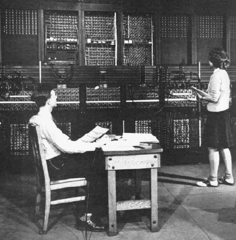
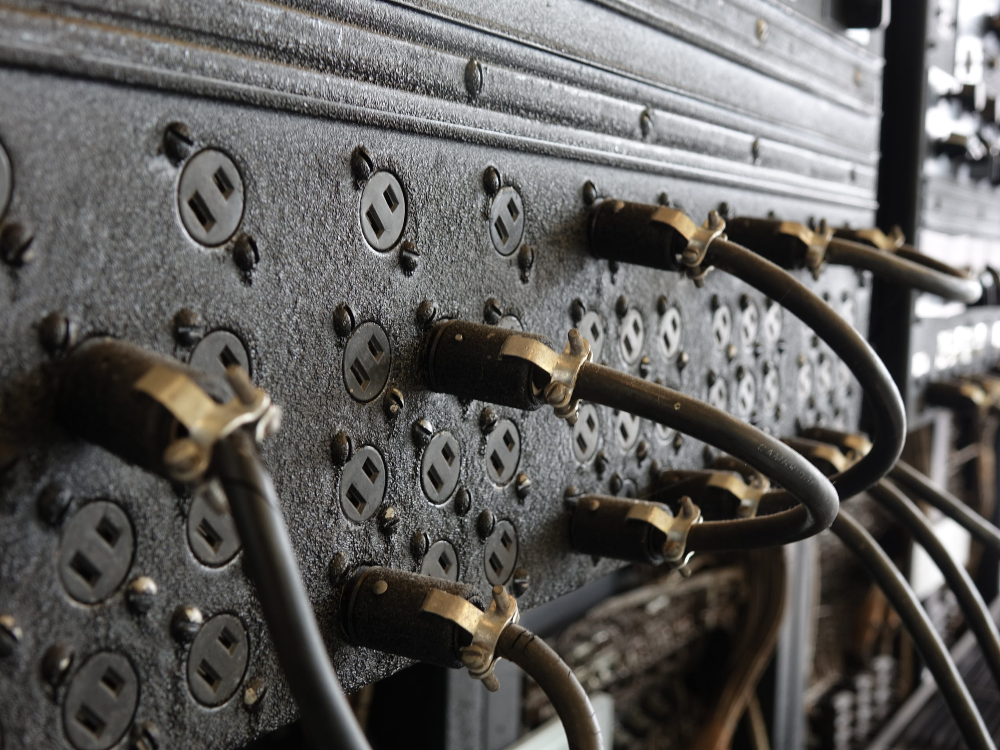

# 9. Performance, Integration and Limitations

## 9.1 Hardware Integration
A integração do hardware do ENIAC ocorria por meio da conexão entre suas unidades de processamento, seus mecanismos de controle e seus dispositivos de armazenamento de dados e instruções. Diferentemente dos computadores modernos, que utilizam uma arquitetura integrada com memória eletrônica para armazenar programas e dados, o ENIAC dependia de módulos físicos especializados e de configurações manuais para executar suas operações.

**Processamento:** O processamento matemático era realizado por unidades especializadas, como os 20 acumuladores, responsáveis por operações de adição e subtração, e a unidade multiplicadora, destinada a cálculos de multiplicação. Essas unidades trabalhavam em conjunto, transmitindo valores numéricos por meio de conexões elétricas e pulsos eletrônicos.

**Controle:** O controle das operações era realizado principalmente pelas unidades de Cycling Unit e Master Programmer, responsáveis por coordenar a sequência de execução, sincronizar as operações e determinar quando as diferentes unidades deveriam atuar. A programação era configurada manualmente por meio de cabos, interruptores e painéis, estabelecendo os caminhos pelos quais os dados e os sinais de controle circulavam.

**Armazenamento:** Os resultados intermediários e os valores numéricos utilizados durante os cálculos eram mantidos principalmente nos acumuladores, que funcionavam como registradores de armazenamento temporário. Já os dados de entrada podiam ser fornecidos por meio de cartões perfurados, enquanto os resultados eram apresentados em dispositivos de saída, como perfuradoras de cartões e impressoras. A configuração do programa, por sua vez, dependia das conexões físicas e dos ajustes realizados pelos operadores.

**Integração entre os componentes:** O funcionamento conjunto dessas unidades dependia da coordenação entre os sinais de controle e a transferência de dados. O sistema de controle determinava a ordem das operações, os módulos de processamento realizavam os cálculos e os acumuladores mantinham os valores necessários para as etapas seguintes. Dessa forma, o ENIAC conseguia executar sequências complexas de operações matemáticas, embora sua integração dependesse de uma infraestrutura física extensa e de uma configuração manual relativamente trabalhosa.
Portanto, a integração do hardware do ENIAC representou um avanço importante na computação eletrônica, pois permitiu que diferentes unidades especializadas trabalhassem de maneira coordenada. Entretanto, a dependência de conexões físicas e a ausência de uma memória central para armazenar o programa limitavam a flexibilidade do sistema e tornavam a reconfiguração para novos problemas um processo demorado.

## 9.2 Computational Speed
O ENIAC foi projetado para ser uma máquina muito mais rápida que outras máquinas eletromecânicas de sua época. Porém, existia uma diferença no tempo de execução entre suas operações matemáticas: geralmente adições e subtrações eram realizadas de modo muito mais rápido que multiplicações, divisões e raíz quadrada.

Um artigo técnico publicado em 1946 por J. G. Brainerd e T. K. Sharpless [17], engenheiros envolvidos no desenvolvimento do ENIAC, apresenta os seguintes valores de desempenho:

| Operação | Tempo de Execução | Operações por Segundo |
|---|---:|---:|
| Adição ou Subtração | 200 μs | 5.000 |
| Multiplicação de dois números de 10 dígitos | 2.800 μs (2,8 ms) | 360 |
| Consulta a uma função na Function Table | 1.000 μs (1 ms) | 1.000 |
> Fonte: artigo técnico The ENIAC, publicado em 1946.

Para compreender esses números:
- Adição e subtração: eram as operações mais rápidas. Uma adição podia ser concluída em 200 microssegundos, ou seja, 0,0002 segundo.
- Multiplicação: exigia aproximadamente 2,8 milissegundos, o equivalente a 14 ciclos básicos de adição.
- Consulta às Function Tables: levava aproximadamente 1 milissegundo para recuperar um valor armazenado nas tabelas de funções.

Uma publicação técnica de 1949 [18] registra que o ENIAC conseguia realizar aproximadamente 50 divisões ou extrações de raiz quadrada por segundo. Já um relatório do Office of Naval Research, referente ao período de 1951–1952 [16], registra cerca de 40 operações por segundo. Essa diferença é pontual: os valores podem variar conforme a configuração e as condições de operação da máquina. Portanto, é possível inferir que existia uma faixa aproximada de 40 a 50 operações por segundo para essas operações.

Além disso, outros documentos históricos registram que o desempenho podia mudar com modificações na configuração. Em 1952, por exemplo, um relatório [16] registrou taxas de 1.666 adições, 1.000 subtrações, 294 multiplicações e aproximadamente 40 divisões ou extrações de raiz quadrada por segundo.

## 9.3 Setup x Execution
Uma das características mais marcantes do ENIAC era o tempo destinado a sua preparação em comparação com sua execução dos cálculos. Além disso, devido a ausência de uma memória central, o ENIAC dependia de uma configuração física da máquina, como conexão de cabos nos painéis de programação, ajuste de interruptores e configuração das unidades de processamento.

Esse processo envolvia várias etapas:
1. Planejamento: os matemáticos precisavam estudar o problema e dividir os cálculos em sequências de operações que o ENIAC pudesse executar.
2. Programação: era necessário determinar quais unidades seriam utilizadas, como os dados circulariam e em que ordem as operações aconteceriam.
3. Configuração física: os operadores conectavam os cabos nos painéis e ajustavam os interruptores e as tabelas de funções.
4. Testes e verificação: a equipe verificava as conexões, executava testes e corrigia possíveis erros antes de realizar os cálculos definitivos.

Assim, o tempo de preparação podia ser muito maior que o próprio tempo de execução.

> Arthur Burks and Betty Jean Jennings operando o ENIAC

De acordo com Franz Alt, ....

## 9.4 Energy Consumption

Por ser uma máquina derivada de uum trabalho impressionante de engenharia elétrica, o Eniac tinha um consumo avassalador, em decorrência de ter sido projeto de uma forma mais bruta, sem a preocupação com refinamento em sua economia energetica. Logo, cada ligação de válvula termionica e seus componentes eram altamente energizados, e principalemnte, ficavam ligados constantemente.

Desse modo, a estimativa direta seria que o sistema consumia cerca de 150 kW em 1946. Sendo que em alguns ápices de processamento e em certas circunstâncias poderia alcançar 174 kW.

> O valor de 174 Kw é estimativo e não foram encontradas citações oficias. Porém em determinadas circunstâncias, como quando o Eniac foi movido para a cidade de Maryland, onde foi remontado na Aberdeen Proving Ground. A região por ser mais ao sul é mais quente que a cidade natal do Eniac, Pensilvânia. Logo, existe uma base real para acreditar que seu consumo energético subiu após ser transferido.

### 9.4.1 Divisão do consumo

segundo o comunicado de imprensa do Departamento de Guerra (fev. 1946). Os componentes e seus gastos seriam, o aquecimento dos filamentos das válvulas com 80 kW, no total resultando em cerca de 53% do consumo geral. A geração das tensões CC com 45 kW e complementando 30% do gasto. A ventilação (sopradores), que consumiam 20 kW, totalizando 13% (muito provacelmente foram os componentes que sofreram um aumento de consumo em Maryland). E por fim as máquinas de cartão auxiliares com um consumo mais moderado de 5 kW, sendo apenas 3% do total. 
A alimentação era trifásica, regulada, de 240 V e 60 Hz. Sendo uma montagem elétrica bem parruda para a época, reforçando a ideia de que o Eniac foi projetado pensando em resultados e não em economia.

### 9.4.2 Explicação do maior gasto

Como foi demonstrando, os filamentos das vávulas representam mais da metado do consumo de energia do Eniac, e isso se dá pelo fato de que toda válvula precisa de seu aquecedor ligado o tempo todo, mesmo sem conduzir. Como a operação era 24 h por dia, 7 dias por semana, esse gasto nunca parava. Com aproximadamente 17.500 válvulas, isso chegava a um valor absurdo, próximo de 4,6 W por válvula só de aquecimento. Nessas circunstâncias, com uma conta simples chegamos na conclusão que, com o sistema gastando 150 kW × 24 h = 3.600 kWh. Se considerarmos o aumento para 174, o valor sobe mais ainda, chegando a impressionates 4.200 KWh. 

> Um fato curioso é que quase toda essa energia virava calor na sala. O ENIAC usava ar externo forçado, sem ar-condicionado dedicado, e os sopradores não bastavam no clima quente e úmido de Maryland. Aparentemente esse problema nunca foi resolvido.

### 9.4.3 Qualidade da rede e upgrades

Posteriormente algumas modificações (como o mecanismo de programa central) eliminaram cerca de 3.000 válvulas, o que também reduziu o consumo, e em meados de 1950, as oscilações de tensão da rede comercial causavam erros e perda de informação. A solução foi um grupo motor-gerador, em que a inércia do motor estabilizava a alimentação. 

> Outra curiosidade é que surgiram mitos em jornais da época, afirmando que algumas regiões, como a Filadélfia sofreram com quedas de energia e blackouts em decorrência do uso do Eniac na rede. Contudo, alguns pesquisadores como Eckert, desmentiram, e considerando que posteriormente o sistema recebeu um gerador próprio. É bem crivel que tenha sido sensacionalismo da mídia.

## 9.5 Vacuum Tube Failure Rate

Como as válvulas termionicas podem ser vistas como uma peça análoga a uma lampâda em seu funcionamento básico, era comum que devido ao uso e estresse elas acabassem queimando, e existia não só uma preocupação com esse tipo de erro, mas também métodos para precaver não exatamente a queima, mas sim, sua  troca.

### 9.5.1 Frequência

Quando montado na faculdade de Moore School, uma válvula falhava a cada cerca de dois dias, e o defeito era localizado em até 15 minutos. Um tempo um tanto maior para um uso tão intenso. Já após ser movido para Aberdeen as válvulas queimavam quase todo dia e a máquina ficava fora do ar cerca de metade do tempo. A taxa foi reduzida para uma a cada dois dias, e em 1954 houve uma operação contínua de 116 h. Todo esse aumento pode ser explicado novamente pelo aumento de temperatura média da região.

### 9.5.2 Motivo das falhas

O motivo mais claro é o choque termico, a maior parte das falhas ocorria ao ligar e desligar, quando filamentos e catodos sofrem mais. Por isso o ENIAC passou a ficar ligado direto. O próprio uso 24 horas todos os dias é um efeito dessa escolha. Outro problema era o calor ambiente, a ventilação inadequada encurtava a vida das válvulas e causava longas paradas. Ambos os problemas eram amplificados pela qualidade das peças, eram válvulas comuns de prateleira, sendo que por se tratarem de peças convencionais não eram ideais para computadores. Válvulas especiais de alta confiabilidade só chegaram em 1948.

> Havia também o efeito do catodo ocioso. Em computadores a válvula, tubos longos sem condução podem formar uma camada de alta resistência no catodo. Esse problema era comum e generalizado em máquinas com válvulas termionicas. Embora não haja documentação oficial indicando este no Eniac, é justo imaginar que era um risco comum e poderia ocorrer com certa frequência.

### 9.5.3 Métodos de mapeamento

Era possivel utilizar os modos de operação para localizar o problema, o ciclador permitia rodar em um pulso ou um tempo de adição por vez, e depois de 1948 também por instrução. Assim a máquina parava no meio da operação. Isso era somado as lampâdas de neon, cada flip-flop tinha uma no painel, quando comparavam o estado esperado com o real, o resultado apontava qual estágio, e portanto qual válvula havia falhado.

> Imagine que numa soma, justamente a lampâda de um dos anéis se acsendia de forma não esperada. Isso significava que alguma das válvulas presentes naquele painel estava deturpada.

Quando as programadoras faziam testes, muitas vezes localizavam o defeito até uma válvula individual, que o técnico então trocava de forma bem prática, visto que o sistema contava com chassis removíveis, tinham 44 tipos de unidades plug-in, e a troca levava segundos. No entanto esse tempo é considerado quando o problema já havia sido determinad, e para isso era necessário passar pela rotina de checagem. Só ela levava cerca de 8 horas.
A partir de 1950, válvulas eram testadas e as falhas, registradas em estatística. A ideia era usar os dados para prever e remediar falhas mais comuns do sistemas, sem depender de erros imprevistos. Gerando assim uma espécie de "tabela de erros".

> Outro truque comum era o teste de margem, que é a prática geral de baixar tensões para provocar falhas antes que atrapalhem. Essa era uma técnica usada de forma ampla em computadores com válvulas termiônicas. Da mesma forma que o problema de efeito cátodo, não há documentação oficial ligando esse método ao Eniac, mas visto que era uma prática comum para lidar erros das válvulas, é muito provavel que tenha sido utilizado amplamente.
 
## 9.6 I/O Bottleneck

A arquitetura do ENIAC criava um paradoxo de desempenho fascinante: a máquina era um colosso eletrônico capaz de operar na escala dos microssegundos, mas estava fisicamente acorrentada à lentidão de engrenagens, roletes e papel cartonado. Essa disparidade fundamental entre a velocidade de processamento interno e a velocidade de entrada e saída de dados gerava o maior gargalo de performance de todo o sistema.

### 9.6.1 Speed Disparity
Para compreender a gravidade desse gargalo, é necessário observar os números absolutos. Como detalhado no tópico 9.8.1, o ciclo básico da máquina levava 200 microssegundos, permitindo que um Acumulador realizasse 5.000 adições por segundo. Em contrapartida, os periféricos eletromecânicos da IBM operavam em um ritmo ditado pela física dos materiais:

- Input (Leitor de Cartões): Operava a uma taxa máxima de 125 cartões por minuto (aproximadamente 2 cartões por segundo).
- Output (Perfurador de Cartões): Era ainda mais lento, operando a uma taxa máxima de 100 cartões por minuto (cerca de 1,6 cartões por segundo), pois a ação mecânica de cravar lâminas de aço no papel exigia mais força e tempo do que simplesmente deslizar escovas elétricas sobre ele.

Isso significava que, no tempo necessário para que o Leitor de Cartões puxasse, lesse e ejetasse uma única folha de papel (cerca de 0,48 segundos), o ENIAC era capaz de executar mais de 2.400 ciclos de adição. Se um algoritmo fosse mal planejado e obrigasse a máquina a parar seus cálculos para esperar a leitura do próximo cartão, as válvulas eletrônicas ficariam ociosas por 99,9% do tempo, anulando completamente o propósito de se construir um computador eletrônico.

### 9.6.2 Algorithmic Mitigation
Para contornar essa limitação física, as equipes de programação precisavam estruturar o fluxo de dados de forma a isolar a máquina do mundo exterior pelo maior tempo possível. A regra de ouro da performance no ENIAC era: leia o mínimo possível, calcule o máximo possível internamente, e imprima apenas o estritamente necessário.

Foi exatamente para mitigar esse gargalo que unidades como o Constant Transmitter (com suas chaves rotativas manuais) e as Function Tables (Tabelas de Função) foram projetadas. Ao configurar as constantes matemáticas e as funções complexas diretamente no hardware através de interruptores e resistores, os programadores ancoravam os dados pesados dentro da própria máquina. Assim, o Leitor de Cartões era acionado apenas no primeiro segundo de execução para fornecer as variáveis iniciais de um problema. A partir desse ponto, o ENIAC entrava em um loop de processamento puramente eletrônico, rodando milhares de iterações em paralelo sem precisar interagir com o papel, até que o resultado final estivesse pronto para acionar o lento Perfurador de Cartões.

## 9.7 Suitability for Ballistics
O ENIAC não foi financiado e construído pelo Exército dos Estados Unidos apenas para ser uma máquina de calcular genérica. Seu desenvolvimento foi uma resposta direta a uma crise matemática militar: a necessidade de produzir Tabelas de Tiro (Tabelas Balísticas) para a artilharia durante a Segunda Guerra Mundial. A arquitetura descentralizada do ENIAC, incluindo a forma como lidava com o gargalo de I/O, era a tradução perfeita em hardware das equações diferenciais necessárias para resolver esse problema específico.

### 9.7.1 Atillery Trajectories
Calcular a trajetória de um projétil de artilharia não é uma simples equação de parábola de física de ensino médio. No mundo real, um projétil é afetado pela gravidade, pela densidade do ar (que muda conforme a altitude), pela velocidade do vento, pela rotação da Terra e, principalmente, pelo arrasto aerodinâmico (que varia drasticamente dependendo se o projétil está em velocidade subsônica ou supersônica).

Para descobrir onde uma bomba cairia, os matemáticos precisavam usar métodos de integração numérica (como o Método de Euler ou o Método de Heun). Isso envolvia quebrar o tempo de voo do projétil em frações minúsculas (ex: passos de 0,1 segundo). A equipe calculava a posição e a velocidade no tempo 0; usava esses resultados para calcular o arrasto e a nova posição no tempo 0,1; usava esses novos resultados para o tempo 0,2, e assim sucessivamente até que a altitude chegasse a zero (o impacto). Uma única trajetória exigia milhares de cálculos repetitivos em cascata.

### 9.7.2 Architectural Alignment
A arquitetura do ENIAC era um espelho exato desse método de integração numérica. O problema balístico era o cenário perfeito para o hardware da máquina pelos seguintes motivos:

- Paralelismo Físico: Como a posição de um projétil possui eixos X (distância) e Y (altitude), os cálculos de ambos os eixos precisavam ser atualizados a cada passo de tempo. O ENIAC podia usar um grupo de Acumuladores para processar a física do eixo X simultaneamente a outro grupo de Acumuladores processando a física do eixo Y. Isso cortava o tempo de execução da integração numérica pela metade.

- Hardcoding do Arrasto Aerodinâmico: A função de arrasto do ar era a parte mais complexa da equação, pois não era linear. O ENIAC possuía três Function Tables portáteis gigantescas. Os engenheiros mapeavam a curva de arrasto do ar diretamente nas centenas de interruptores dessas tabelas. Durante o voo simulado, a máquina consultava a tabela em velocidades eletrônicas para descobrir a resistência do ar na exata velocidade atual do projétil, sem precisar ler um único cartão perfurado para obter essa informação.

- A Simbiose com o Gargalo de I/O: O cálculo balístico era imune ao gargalo do Leitor de Cartões. Para calcular uma trajetória que durava 60 segundos de tempo de voo real, o ENIAC precisava ler apenas um ou dois cartões iniciais contendo o ângulo do canhão, a velocidade da pólvora e a densidade do ar local. A máquina então passava os próximos 20 segundos rodando loops internos furiosamente, calculando centenas de passos de tempo. O Perfurador de Cartões só era acionado de forma intermitente para registrar a posição do projétil a cada poucos segundos de voo simulado.

Em resumo, a arquitetura do ENIAC era perfeitamente adequada para a balística porque o problema exigia um volume massivo de iterações matemáticas internas e processamento paralelo, mas exigia uma quantidade minúscula de tráfego de entrada e saída, permitindo que a máquina operasse em sua velocidade eletrônica máxima sem ser estrangulada por seus periféricos mecânicos.

## 9.8 Architectural Decisions
O ENIAC foi desenvolvido para executar cálculos complexos em alta velocidade comparado às opções da época. Uma das suas funções era o processamento paralelo, que auxiliava justamente na contagem balística dos EUA na época em que foi lançado publicamente.
O computador possuía 20 acumuladores eletrônicos e cada um era capaz de armazenar números decimais de 10 dígitos com sinal (+ ou -), além de resolver operações de adição e subtração.
O paralelismo era especialmente útil no processamento de equações matemáticas, pois vários acumuladores podiam trabalhar simultaneamente em diferentes etapas de um mesmo problema.

## 9.8.1 Especificações técnicas da velocidade
Frequência dos pulsos de sincronização, 100 kHz
Intervalo entre os pulsos, 10 microssegundos
Ciclo básico de adição, 200 microssegundos
Velocidade de adição, até 5.000 adições por segundo, por unidade em funcionamento
Multiplicação de 2 números de 10 dígitos, aproximadamente 2,8 milissegundos

Os pulsos de sincronização eram comandados pela Cycling Unit, que comandava e coordenava todas as unidades independentes e ditava quando deveriam ser feitas as operações matemática, como fosse o "coração" do computador.

## 9.8.2 Como o paralelismo aumentava a velocidade?
O processamento paralelo permitia que vários acumuladores realizassem operações matemáticas ao mesmo tempo, desde que um não dependesse do resultado do outro.

Por exemplo, 4 acumuladores precisam realizar 4 operações diferentes:
Acum. 1: 100 + 200 = 300
Acum. 2: 500 + 200 = 700
Acum. 3: 300 - 120 = 180
Acum. 4: 600 + 150 = 750

Considerando os ciclos citados, sem o paralelismo seriam necessários 4 ciclos para realizar as 4 operações. Porém, com o paralelismo integrado, todas as 4 operações são realizadas em um mesmo ciclo de 200 microssegundos. Sendo assim, o paralelismo nesse caso evolui de 800 μs (4 ciclos de 200 μs) para 200 μs (1 ciclo). 

## 9.8.3 Dificuldade de configuração
Apesar da velocidade de processamento, a configuração do computador ainda era um processo complexo, demorado e sujeito a erros humanos.
Ao contrário dos computadores atuais, a configuração do ENIAC era física (com cabos, bandejas, cartões perfurados) e precisava ser configurado novamente para cada novo conjunto de cálculos.

## 9.8.4 Principais dificuldades técnicas
Conexões físicas: os cabos de programação e transmissão de dados precisavam ser alterados e reconfigurados a cada problema matemático, grandes alterações no algoritmo podiam exigir alterar diversas conexões.
Sincronização dos acumuladores: as operações paralelas não necessariamente finalizavam ao mesmo tempo, por isso era necessário coordenar os pulsos para que uma unidade não tentasse utilizar um resultado que ainda não estivesse pronto.
Identificação de erros: uma conexão incorreta poderia comprometer os resultados, assim era necessário verificar fisicamente as conexões e testar operações para conseguir identificar a raiz do erro.
Tempo de preparação: problemas mais complexos podiam exigir dias de configuração, mesmo sequer antes de iniciar a execução dos cálculos, pois tudo precisava estar de acordo antes de colocar o computador para funcionar. Segundo relatos históricos do governo dos EUA, a preparação de um problema de trajetória balística podia levar até 3 dias, enquanto a execução do problema podia ser finalizada em segundos.

## 9.8.5 Por que o paralelismo dificultava a programação (ainda mais)
A principal dificuldade do paralelismo, em relação à programação, era ter de organizar várias sequências de operações simultâneas.
No ENIAC, o programador precisava considerar quais unidades podiam trabalhar simultaneamente, quais resultados seriam compartilhados entre unidades e o momento certo em que a operação deveria começar. Assim, o processamento paralelo exigia ainda mais planejamento do que um processo sequencial, necessitando atenção detalhada nas conexões e fluxo de pulsos elétricos.

## 9.8.6 Relação entre a velocidade e o tempo de configuração
A relação entre ambos se assemelhava ao conceito do gargalo de Von Neumann. Enquanto tínhamos à disposição uma velocidade de processamento considerável, que realizava diversos cálculos complexos em segundos, a configuração e planejamento exigiam horas ou até dias de trabalho dos programadores.
Assim, a utilização do ENIAC era especialmente importante em problemas que exigiam cálculos repetitivos, como as tabelas balísticas dos EUA. 

## 9.4 Energy Consumption
- Quanta energia o ENIAC usava para operar normalmente

## 9.5 Vacuum Tube Failure Rate
- Com que frequência as válvulas queimavam e quanto tempo era necessário para encontrar a defeituosa

## 9.6 I/O Bottleneck
- Havia um gargalo enorme entre o input/output mecânico e processamento eletrônico

## 9.7 Suitability for Ballistics
- Por que essa arquitetura específica era perfeita para calcular trajetórias de artilharia

## 9.8 Architectural Decisions
- Sobre a velocidade do processamento paralelo e a dificuldade de configuração
- Sobre a velocidade do processamento paralelo e a dificuldade de configuração
