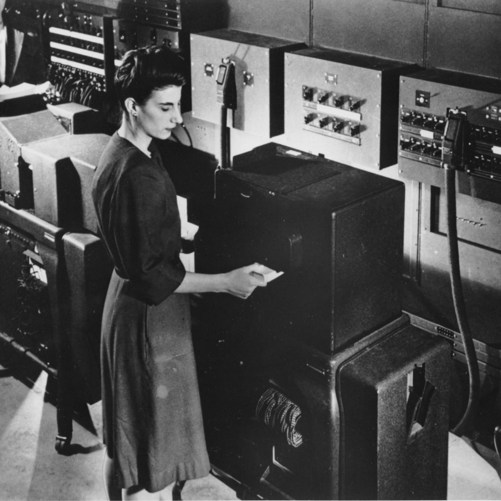

# 11. Operation

## 11.1 Input
- Quais são as informações introduzidas no sistema 

## 11.2 Configuration
- Como o sistema está configurado nessa operação

## 11.3 Components
- Quais componentes participam da operação

## 11.4 Routing
- Como as informações circulam pelo sistema durante a operação

## 11.5 Operations
- Quais operações são realizadas durante a operação principal

## 11.6 Output
A saída do ENIAC, ou Output, é a informação gerada pelo computador sendo transmitida para o usuário. Nos computadores modernos, o Output pode ser feito pelo monitor ou por uma impressora, por exemplo. Já no ENIAC, a saída era feita de maneira física, por cartões perfurados.

O processo do ENIAC era dividido em 3 etapas:
1. Processamento de informações, onde o computador realizava as operações matemáticas.
2. Registro físico, onde a informação era repassada para a Punch Card Machine, que perfurava os cartões para representar os valores numéricos.
3. Apresentação dos resultados, onde uma tabuladora lia o cartão perfurado de saída e traduzia os valores em papel.

> Obs.: Esse processo dividido em 3 etapas era importante, pois permitia que o ENIAC continuasse processando informações e executando operações enquanto registrava a saída (output) de outros dados.

### 11.6.1 Cartões Perfurados
Os cartões perfurados eram feitos de papel-cartão rígido com 80 colunas. Cada coluna continha 12 posições de perfuração e as linhas eram nomeadas em:
12, 11, 0, 1, 2, 3, 4, 5, 6, 7, 8 e 9

Assim, se fôssemos representar o valor 415, utilizaríamos 3 colunas com perfurações nas linhas 4, 1 e 5, respectivamente. 

Ademais, não era o próprio ENIAC que perfurava os cartões de saída, mas sim o equipamento de perfuração de cartões da IBM, conhecido como Summary Punch.

O passo a passo da impressão da saída era a seguinte:
1. O ENIAC realizava a operação e guardava os resultados nos acumuladores.
2. Uma unidade chamada Printer recebia a informação dos resultados que serão enviados para a saída.
3. A Printer enviava esses dados para um relés eletromecânico que armazenava os dados e enviava os sinais para a IBM Summary Punch.
4. A IBM Summary Punch fazia as perfurações no cartão, com os dados que a foram enviados.
5. O cartão era enviado para a pilha de saída, onde era lido, armazenado ou recolocado à entrada (input) do ENIAC para dar início à novas operações.

> Obs.: A Printer, apesar de ser traduzida "impressora", não imprimia nada. Essa unidade, na verdade, preparava os dados para saída e controlava o equipamento externo de perfuração.

### 11.6.2 Principais limitações
Como limitações da saída do ENIAC, podemos citar diversos fatores, tais quais:
1. Velocidade eletromecânica. Apesar do processamento do ENIAC ser extremamente rápido, a perfuração dos cartões era muito mais lenta.
2. Capacidade de armazenamento. Os cartões continham número limitado de valores que podiam armazenar, gerando diversas pilhas de cartões para algumas operações.
3. Dependência de equipamentos externos. A impressão dos resultados exigia uma máquina tabuladora separada.
4. Organização manual. Devido à saída física, é necessário o manejo de pilhas de cartões perfurados, o transporte e a organização em ordem adequada.
5. Ausência de visualização moderna, como um monitor ou tela, que mostrasse o resultado imediatamente.

> Obs.: Enquanto o ENIAC conseguia executar 5.000 adições por segundo, a perfuradora registrava aproximadamente 100 cartões por minuto, sendo cerca de 1,67 cartões por segundo. 
> Vale citar que um cartão não equivale à uma adição, mas ainda assim a discrepância segue sendo muito grande.

