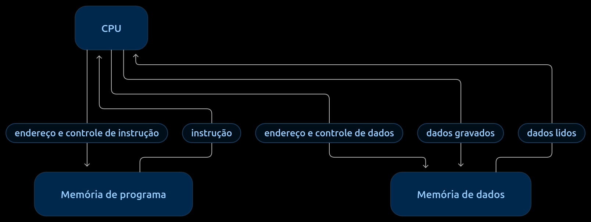

# 2. System Overview

## 2.1 General Description
A arquitetura Harvard é um modelo de organização de computadores que utiliza memórias separadas para armazenar instruções e dados, além de barramentos independentes para acessá-los. Seus principais componentes são a CPU (Unidade Central de Processamento), a memória de instruções, a memória de dados e os barramentos de comunicação. Essa separação permite que o processador busque instruções e acesse dados de forma independente, podendo realizar essas operações simultaneamente.

## 2.2 Main Components

A organização Harvard clássica pode ser descrita por quatro elementos principais:
- CPU (Unidade Central de Processamento): busca e interpreta instruções e realiza as operações solicitadas pelo programa. Em geral, inclui a Unidade de Controle, a ULA e registradores, embora a organização interna varie conforme o processador.
- Memória de programa: armazena as instruções que a CPU busca para executar o programa.
- Memória de dados: armazena valores que podem ser lidos ou gravados durante a execução, como dados de entrada, valores temporários e resultados.
- Caminhos de comunicação: conectam a CPU às memórias de programa e de dados. Na organização Harvard clássica, esses caminhos são independentes. Eles transportam informações como instruções, dados, endereços e sinais de controle. A forma física e a largura desses caminhos dependem da implementação.

## 2.3 Block Diagram

    

    *Figura 1 — Representação conceitual da CPU, das memórias de programa e de dados e de seus caminhos independentes de comunicação.*

    subgraph CPU [Unidade Central de Processamento]
        UC[Unidade de Controle]
        ULA[Unidade Logica e Aritmetica]
        REG[Registradores]
    end

    subgraph MemProg [Memoria de Programa]
        Instrucoes[Instrucoes do Sistema]
    end

    subgraph MemDados [Memoria de Dados]
        Dados[Dados / Variaveis]
    end

    CPU <==> |Barramento de Instrucoes| MemProg
    CPU <==> |Barramento de Dados| MemDados

    style CPU fill:#f9f9f9,stroke:#333,stroke-width:2px
    style MemProg fill:#e1f5fe,stroke:#0288d1,stroke-width:2px
    style MemDados fill:#e8f5e9,stroke:#388e3c,stroke-width:2px
    
    A Arquitetura Harvard Clássica possui espaços de memória e barramentos de comunicação totalmente independentes para instruções e para dados.
    CPU: Contém a Unidade de Controle, ULA e Registradores.
    Memória de Programa: Armazena estritamente as instruções do sistema.
    Memória de Dados: Armazena as variáveis e dados operacionais.
    Barramentos Independentes: Permitem que a CPU acesse instruções e dados simultaneamente.

## 2.4 Data Flow
O processador busca as instruções na memória de instruções por meio de um barramento específico e acessa os dados por outro barramento. Em seguida, interpreta e executa as instruções, utilizando a memória de dados quando necessário. Como os caminhos são separados, a busca de uma nova instrução pode ocorrer enquanto a instrução anterior está sendo executada, dependendo da implementação.

## 2.5 Main Characteristics

| Feature | Description |
|---------|-------------|
|Memórias separadas|Instruções e dados são armazenados em espaços de memória distintos.|
|Barramentos independentes|Existem caminhos separados para a transferência de instruções e dados.|
|Acesso simultâneo|O processador pode buscar instruções e acessar dados ao mesmo tempo.|
|Redução de conflitos|A separação dos barramentos diminui a disputa pelo acesso à memória.|
|Eficiência de processamento|O acesso independente pode melhorar o desempenho do sistema.|
|Complexidade de hardware|A utilização de caminhos e memórias separados pode aumentar a complexidade do projeto.|
|Organização flexível|As memórias de instruções e dados podem ter capacidades e larguras diferentes.|
