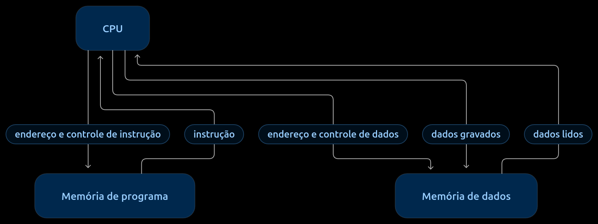

# 2. System Overview

## 2.1 General Description

A organização Harvard clássica separa o espaço de armazenamento de instruções do espaço de armazenamento de dados e prevê caminhos de acesso independentes para esses espaços. Essa descrição define a organização da memória; não determina uma CPU específica, uma ISA, registradores, barramentos físicos com determinada largura ou um comportamento temporal. A separação pode permitir acessos independentes, mas a ocorrência de acessos simultâneos depende da implementação (Arvind et al., 2015, cap. 5).

## 2.2 Main Components

O diagrama conceitual pode representar um processador conectado a duas memórias:

- **Memória de instruções:** fornece as instruções do programa.
- **Memória de dados:** fornece ou recebe valores usados durante o processamento.
- **Processador:** executa as operações do programa. Unidade de controle, ULA e registradores são componentes comuns de uma implementação, mas não são definidos pelo modelo Harvard.
- **Caminhos de acesso:** representam separadamente a comunicação com cada espaço. Sua forma física, largura e protocolo dependem da implementação.

## 2.3 Block Diagram

*Figura 1 — Processador, memórias de instruções e de dados e caminhos independentes. O diagrama é conceitual; componentes internos e acesso simultâneo dependem da implementação.*

## 2.4 Data Flow

O processador obtém instruções pelo caminho associado à memória de instruções. Quando a operação requer dados, acessa o espaço de dados pelo caminho correspondente; o resultado pode ficar em registradores ou ser escrito na memória de dados, conforme o projeto. Os acessos a instruções e dados podem ocorrer de forma sobreposta quando as memórias, as interfaces e o controle oferecem suporte. A figura não representa uma sequência de ciclos obrigatória (Arvind et al., 2015).

## 2.5 Main Characteristics

| Característica | Descrição |
|---|---|
| Espaços separados | Instruções e dados pertencem a espaços de armazenamento distintos. |
| Caminhos independentes | A comunicação com cada espaço é separada no modelo clássico; detalhes físicos dependem do projeto. |
| Acessos concorrentes | Podem ocorrer se a implementação conseguir atender aos pedidos no mesmo intervalo. |
| Flexibilidade de dimensionamento | Capacidades e larguras podem diferir conforme a implementação. |
| Trade-off | Memórias e caminhos separados podem exigir recursos adicionais; custo e impacto dependem do projeto. |
| Desempenho | Não há ganho universal garantido pelo nome Harvard; tarefa e implementação importam. |