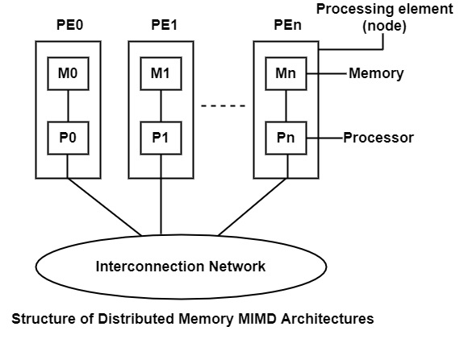

# 2. System Overview

## 2.1 General Description
The system is modeled as a MIMD (Multiple Instruction, Multiple Data) parallel architecture. Unlike single-stream models, it features multiple autonomous processing units (cores or processors) capable of executing different instructions on independent data streams simultaneously, enabling high-performance parallel computation and distributed task execution.
## 2.2 Main Components

- CPU: Multiple independent processing cores, each equipped with its own control unit and arithmetic logic unit (ALU), allowing concurrent and distinct execution flows.
- Memory: Shared or distributed memory modules accessible by the processing units via an interconnection network to store data and active instructions.
- Bus: The communication fabric responsible for routing data packets, synchronization signals, and memory requests between the processing cores and the memory subsystem.
- I/O: Subsystems dedicated to handling external data input and output operations asynchronously across the parallel environment.

## 2.3 Block Diagram

## 2.4 Data Flow
Data moves independently through the architecture as follows:

The system distributes distinct subsets of data from the memory subsystem via the interconnection network to the respective processing cores.

Each core concurrently fetches and processes its designated data stream using its independent instruction sequence.

Intermediate or final results are communicated back through the interconnection network to shared memory or other cores as required by the synchronization primitives.

## 2.5 Main Characteristics

| Feature | Description |
|---------|-------------|
| **Instruction Stream** | Multiple instruction streams; different cores can execute entirely different operations at any given time. |
| **Data Stream** | Multiple data streams; processing units operate on distinct sets of data concurrently. |
| **Control Mechanism** | Decentralized or distributed control, where each core manages its own instruction cycle, program counter, and branch logic. |
| **Synchronization** | Relies on explicit synchronization mechanisms (such as barriers, locks, and semaphores) to coordinate tasks sharing resources. |
| **Scalability** | Highly scalable structure capable of increasing throughput by adding more independent processing cores. |
