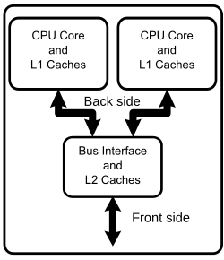

# 3. CPU
MIMD stands for Multiple Instructions, Multiple Data. It is a computer architecture in which multiple processors can execute multiple instructions on different sets of data simultaneously. In MIMD CPUs and CPU cores can work independently. Depending on your system design it can be used with the same main memory or separated local memories, which makes the MIMD´s architecture suitable for a wide range of applications, such as personal computers and supercomputers.

## 3.1 Processor Overview
In MIMD´s architecture, it may contain multiple processors or multiple cores in a single processor. Each processor usually has the following components: r
Registers; ALU; Control Unit (CU); Clock.

## 3.2 Registers
The registers are the high-speed storage inside a CPU. It holds instructions, memory adresses, data and intermediate results. They are faster to access compared to the main memory, allowing CPU to operate more efficiently. In MIMD architecture each core usually have their own architectural registers that allows it to mantain an independent execution flow, meanig they can process different instructions and datasets simultaneously.

## 3.3 ALU
ALU stands for Arithmetic Logic Unit, as the name suggests this component responsible for arithmetic calculations and logic operations that are essential for mathematical calculations, data processing, program execution and decision making. After it receives data from the registers, it performs the opeeration  specified by an instruction, producing a result that can be stored in a register or used by another operation. In MIMD, the different processors or cores may perform different ALU operations at the same time, increasing the processing capacity of the entire system.

## 3.4 Control Unit
The Control Unit directs and coordinates the operations of the processor. It interprets instructions, generates control signals, and determines how data moves between registers, memory, execution units, and aother components of the CPU. It determines which operation should be performed and which internal components are needed to do so. It helps manage the program flow. In MIMD´s architecture each processor or core usually have their own instruction-control and scheduling mechanisms, allowing different cores to execute different instructions independently, being essential to MIMD architecture as it enables independent instruction execution while coordinating the activities of the components within each processor.

## 3.5 Clock
The CPU Clock syncronizes internal activities, including moving data between registers, advancing instructions through different stages of the processing pipeline and starting execution operations, by timing signals that coordinate processor operations.
In MIMD architecture, the Clock signals help to coordinate activities within each core or processor. The cores may operate at different frequencies or adjust their speeds according to what is being done, such as workload, power requirements or temperature. Even tho it ensures the processor components perform their operations in a cordinated manner, it may need additional mechanisms to syncronize separate processors, such as locks, communication protocols and atomic operations.

## 3.6 Instruction Cycle
The instruction cycle is a fundamental part of CPU operation because programs consist in instructions that must be processed by the CPU, the cycle itself is a sequence of steps followed by a processor to retrieve, interpret, and execute an instruction. Fetch, Decode, and Execute.

Fetch:
The processor retrieves the next instruction from memory or instruction cache, the Program Counter contains the address associated with the next instruction to be fetched, which the processor uses to retrieve it and make it available for decoding, and finally the Program Counter is normally updated to identify the following instruction. nevertheless, a branch or jump instruction can change the execution sequence causing the processor to fetch an instruction from a different address. In MIMD architecture, each core or processors can retrieve different instructions at the same time, allowing them to work independently because they can fetch instructions from their own instruction stream.

Decode:
The processor interprets the instruction that has been fetched, the Control Unit determines what operation the instructions represents and then identifies the data and resources needed to perform it. In MIMD architecture, different processors can decode different instrutions at the same time, allowing the cores to process their own work independently.

Execute:
when the operation is completed , it´s result may be stored in memory or in a register, then the processor continues with its following instructions. In MIMD architecture, as said many times previously, the processors can execute different instructions on different datasets simultaneously.

## 3.7 CPU Diagram

## 3.8 Advantages
The main advantages of the MIMD architecture is the parallel processing capability, that improves the performance of the system by dividing the workload, making it flexible and efficient to multitask and allows a wide range of applications.
In a MIMD architecture, the CPU subsystem consists of multiple autonomous processing units (cores or independent processors). Unlike single-stream models, each processor maintains its own program counter and control logic, allowing them to fetch, decode, and execute entirely different instruction streams on independent data sets simultaneously.
## 3.2 Registers
Each processing core is equipped with its own dedicated set of internal registers, including:

Program Counter (PC): Tracks the independent execution address for each core's active instruction stream.

General-Purpose Registers: Store temporary operands and intermediate calculation results locally within each core.

Status/Flag Registers: Maintain the state of arithmetic and logical conditions (such as zero, carry, or overflow) specific to each core's current operation.
## 3.3 ALU
The system features multiple Arithmetic Logic Units (ALUs)—typically one or more per core. This design enables concurrent arithmetic and logical operations across different cores without interfering with each other, maximizing parallel processing throughput.
## 3.4 Control Unit
The control mechanism in a MIMD processor is decentralized or distributed. Each core has its own Control Unit (CU) responsible for:

Directing the internal operations and data paths of its respective core.

Managing independent branch decisions, conditional jumps, and loop repetitions without locking other cores.

Coordinating with synchronization primitives (such as hardware locks or barriers) when shared memory resources must be accessed safely.
## 3.5 Clock
The processing cores may operate under a synchronized global clock or within independent clock domains. While timing coordinates the internal register transfers of each core, execution pacing can diverge because cores process distinct instruction paths at varying speeds.
## 3.6 Instruction Cycle

The classical sequential model (Fetch → Decode → Execute → Write Back) operates independently and concurrently across each core in the MIMD architecture:   Fetch: Each core retrieves the next instruction from its designated memory space using its own Program Counter.Decode: The local Control Unit interprets the fetched instruction. Because cores handle distinct tasks, Core A might decode a floating-point multiplication while Core B decodes a branch instruction.Execute: The respective ALU or execution unit performs the operation on independent data streams.Write Back: Results are stored back into local registers or transferred to shared memory structures through the interconnection network.

## 3.7 CPU Diagram

## 3.8 Advantages
High Parallelism: Capable of executing completely unrelated tasks and algorithms concurrently.

Flexibility: Highly efficient for complex, non-uniform workloads where different data sets require distinct processing steps.

Scalability: Performance scales effectively with the addition of more processing cores.
## 3.9 Limitations
The concerns around the MIMD architecture include the programming complexity, since parallel programs tend to be more difficult to develop than sequential programs. Communication and syncronization overhead, especially in large multiprocessor systems. Higher hardware costs and power consumption. Memory contention, when multiple processors try to acces the same memory resource at the same time, reducing performance and also the difficulties and conflicts in load-balancing and shared-resources.
Synchronization Overhead: Requires careful management using barriers and locks to prevent race conditions when accessing shared data.

Memory Contention: Multiple cores attempting to access shared memory simultaneously can saturate the interconnection bus.

Programming Complexity: Designing and debugging multi-threaded, independent instruction flows is significantly harder than sequential programming
.
## 3.10 Example of Execution (Concrete Task)
To demonstrate the control and sequence of operations in this MIMD system, consider the parallel processing of a large array split between Core 1 and Core 2:

Initiation: The operating system assigns two distinct tasks—processing the first half of an array on Core 1 and the second half on Core 2.

Independent Sequence: Each core independently steps through its instruction cycle (Fetch → Decode → Execute), executing separate loop iterations on its local data subset.

Control Flow & Divergence: Core 1 encounters a conditional branch and takes a different execution path than Core 2, showcasing the independence of MIMD instruction streams.

Synchronization and Termination: Both cores reach a synchronization barrier. Once both tasks complete their individual execution conditions, the results are consolidated, and the program flow concludes.
