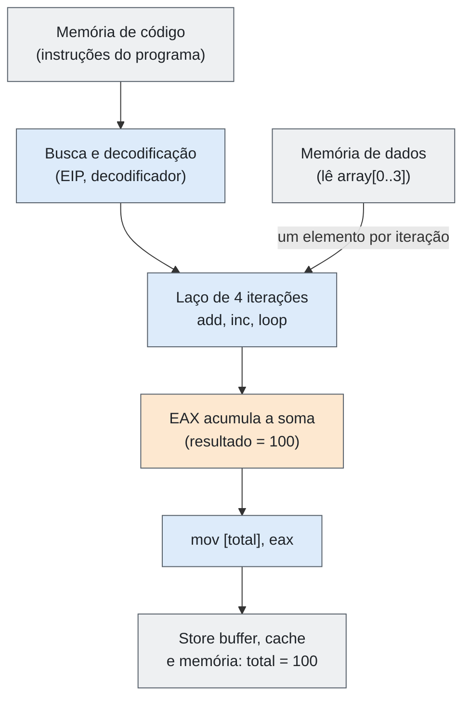
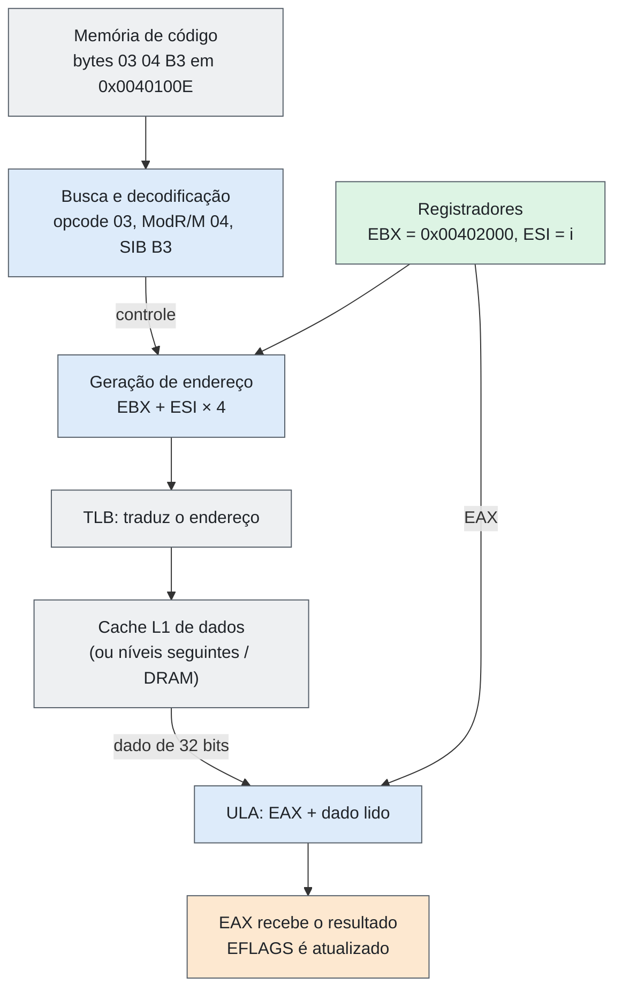
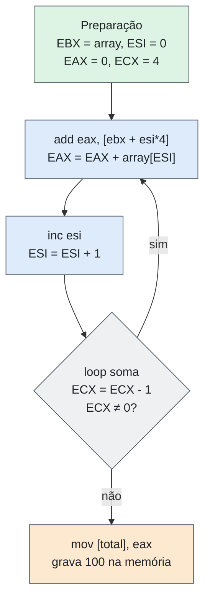

# Entrega 11 — Exemplo Técnico de Funcionamento

| Campo | Descrição |
|---|---|
| **Objeto estudado** | Arquitetura CISC (caso principal: Intel x86 / IA-32) |
| **Entrega** | 11 — Exemplo Técnico de Funcionamento |
| **Data** | 19/11/2026 |
| **Issues relacionadas** | `#29` (PR com `Related to #29`) |
| **Arquivos relacionados** | `assembly-example.asm` (código completo e comentado) |
| **Status** | Pronto para revisão |

> **Escopo:** o conceito de CISC e os modos de endereçamento não são repetidos (já tratados nas entregas 05 e 10). O texto escolhe **uma única tarefa representativa** e a explica passo a passo: entrada, programação, componentes, circulação das informações, operações e resultado. As fontes estão no final.

## Resumo

A tarefa escolhida é **somar os 4 elementos de um vetor de inteiros de 32 bits e gravar o resultado em uma variável (`total`)**, em Assembly x86 (IA-32). Ela é característica de CISC porque a instrução central, `add eax, [ebx + esi*4]`, **calcula um endereço com base, índice e escala, lê a memória e soma, tudo em uma única instrução**. O laço usa ainda `loop`, que decrementa o contador e desvia na mesma instrução, e o programa mistura instruções de **1, 2, 3 e 5 bytes**. A execução faz 4 iterações e termina com `total = 100`, gravado na memória com `mov [total], eax`, num total de **17 instruções executadas**.

## 1. Tarefa escolhida

**Somar os 4 elementos de um vetor de inteiros de 32 bits armazenado na memória e gravar o resultado em `total`.**

| Característica CISC | Onde aparece neste exemplo |
|---|---|
| Operando em memória em instrução aritmética | `add eax, [ebx + esi*4]` lê a memória e soma em uma instrução. Em uma arquitetura load/store seriam instruções separadas. |
| Modo de endereçamento complexo | `[ebx + esi*4]` = base + índice × escala, do mesmo tipo da Entrega 10 (`mov eax, [ebx + esi*4 + 8]`). |
| Instrução de laço dedicada | `loop soma` faz `ECX = ECX - 1` e desvia se `ECX ≠ 0`. |
| Instruções de tamanho variável | Neste programa: 1 byte (`inc esi`), 2 (`xor`, `loop`), 3 (`add`) e 5 (`mov` com imediato ou endereço). |

## 2. Entrada

| Item | Valor |
|---|---|
| Vetor `array` | `{10, 20, 30, 40}`, 4 elementos `dword` de 4 bytes cada |
| Quantidade de elementos | 4 |
| Endereço-base do vetor (didático) | `0x00402000` |
| Endereço da variável `total` (didático) | `0x00402010` |
| Saída esperada | `total = 100` (`0x64`) |

O x86 é **little-endian**: o byte menos significativo fica no endereço mais baixo. Estado inicial da memória de dados:

| Endereço | Conteúdo (bytes) | Significado |
|---|---|---|
| `0x00402000` | `0A 00 00 00` | `array[0] = 10` |
| `0x00402004` | `14 00 00 00` | `array[1] = 20` |
| `0x00402008` | `1E 00 00 00` | `array[2] = 30` |
| `0x0040200C` | `28 00 00 00` | `array[3] = 40` |
| `0x00402010` | `00 00 00 00` | `total = 0` |

## 3. Como o sistema é programado

O programa é escrito em **Assembly x86 (IA-32, sintaxe NASM)**. O arquivo completo está em `assembly-example.asm`.

```nasm
section .data
array   dd 10, 20, 30, 40       ; vetor de 4 dwords
total   dd 0                    ; resultado

section .text
global _start

_start:
    mov  ebx, array             ; EBX = endereço-base do vetor
    xor  esi, esi               ; ESI = 0  (índice)
    xor  eax, eax               ; EAX = 0  (acumulador)
    mov  ecx, 4                 ; ECX = 4  (contador de iterações)

soma:
    add  eax, [ebx + esi*4]     ; EAX = EAX + array[ESI]
    inc  esi                    ; próximo índice
    loop soma                   ; ECX--; se ECX != 0, volta para "soma"

    mov  [total], eax           ; grava o resultado na memória
```

### 3.1 Papel de cada registrador

| Registrador | Função no programa |
|---|---|
| `EAX` | Acumulador da soma (resultado parcial e final) |
| `EBX` | Registrador-base: guarda o endereço de `array` |
| `ESI` | Registrador de índice: posição do elemento atual |
| `ECX` | Contador do laço, usado implicitamente pela instrução `loop` |
| `EIP` | Contador de programa: endereço da próxima instrução |
| `EFLAGS` | Flags atualizadas pelas instruções aritméticas (ZF, SF, CF, OF) |

### 3.2 Como o programa fica na memória (código de máquina)

Endereços de código didáticos, a partir de `0x00401000`:

| Endereço | Bytes (hex) | Tam. | Instrução | Observação |
|---|---|---|---|---|
| `0x00401000` | `BB 00 20 40 00` | 5 | `mov ebx, 0x00402000` | `BB` = `MOV EBX, imm32` (imediato em little-endian) |
| `0x00401005` | `31 F6` | 2 | `xor esi, esi` | Zera ESI |
| `0x00401007` | `31 C0` | 2 | `xor eax, eax` | Zera EAX |
| `0x00401009` | `B9 04 00 00 00` | 5 | `mov ecx, 4` | `B9` = `MOV ECX, imm32` |
| `0x0040100E` | `03 04 B3` | 3 | `add eax, [ebx+esi*4]` | Rótulo `soma` |
| `0x00401011` | `46` | 1 | `inc esi` | `46` = `INC ESI` |
| `0x00401012` | `E2 FA` | 2 | `loop soma` | `FA` = −6: volta para `0x0040100E` |
| `0x00401014` | `A3 10 20 40 00` | 5 | `mov [total], eax` | `A3` = `MOV moffs32, EAX` |

### 3.3 Decodificação da instrução principal: `03 04 B3`

| Byte | Binário | Campo | Significado |
|---|---|---|---|
| `03` | `0000 0011` | Opcode | `ADD r32, r/m32`: soma o operando de memória ao registrador |
| `04` | `00 000 100` | ModR/M | `mod=00` (sem deslocamento), `reg=000` (EAX, destino), `rm=100` (indica que há byte SIB) |
| `B3` | `10 110 011` | SIB | `scale=10` (×4), `index=110` (ESI), `base=011` (EBX) |

**Traço CISC:** a instrução é decodificada em vários campos (opcode + ModR/M + SIB), consequência direta do formato de tamanho variável. O resultado da decodificação é `EAX ← EAX + Memória[EBX + ESI × 4]`.

## 4. Componentes que participam

| Componente | Participação neste exemplo |
|---|---|
| Memória principal e caches | Guardam o programa (código) e os dados (`array`, `total`). |
| Barramentos (endereço, dados, controle) | Transportam endereços, dados e sinais de leitura/escrita entre CPU e memória. |
| Contador de programa (EIP) | Indica qual instrução buscar; é atualizado a cada instrução. |
| Unidade de busca / fila de instruções | Traz os bytes da instrução da memória. |
| Decodificador | Interpreta opcode, ModR/M e SIB e separa a instrução complexa em ações menores. |
| Unidade de controle (microcódigo / micro-operações) | Gera os sinais que coordenam a execução; uma instrução complexa é decomposta em micro-operações. |
| Unidade de geração de endereços | Calcula o endereço efetivo `EBX + ESI×4`. |
| TLB | Traduz o endereço de dados (virtual) em endereço físico. |
| Cache de dados (L1, L2/L3) | Entrega o valor do vetor; em caso de falha, o dado vem do nível seguinte ou da DRAM. |
| Banco de registradores | `EAX`, `EBX`, `ECX`, `ESI`. |
| ULA | Executa a soma, o `inc` e o decremento de ECX. |
| EFLAGS | Recebe o resultado de status das operações aritméticas. |
| *Store buffer* | Guarda a escrita final (`mov [total], eax`) enquanto ela é encaminhada ao cache. |

## 5. Como as informações circulam

**Figura 1 — Caminho geral dos dados no programa**



**Figura 2 — Caminho dos dados em `add eax, [ebx + esi*4]`**



### 5.1 Ciclo da instrução `add eax, [ebx + esi*4]` (1ª iteração)

| Etapa | O que acontece | Informação que circula |
|---|---|---|
| 1. Busca | EIP = `0x0040100E`; a CPU lê 3 bytes da memória de código. | Bytes `03 04 B3` vão da memória para o decodificador. |
| 2. Decodificação | Identifica ADD, destino EAX e operando de memória com SIB. | Campos opcode / ModR/M / SIB. |
| 3. Endereço efetivo | EBX (`0x00402000`) + ESI (0) × 4 = `0x00402000`. | Valores de EBX e ESI vão à unidade de endereços. |
| 4. Leitura da memória | O TLB traduz o endereço; o cache L1 devolve o dado (ou o busca nos níveis seguintes). | `0x00402000` → memória; `0x0000000A` (10) → CPU. |
| 5. Execução | A ULA soma EAX (0) + 10. | Operandos entram na ULA. |
| 6. Escrita | O resultado é gravado em EAX e as flags são atualizadas. | `EAX = 10`; `ZF=0`, `SF=0`, `CF=0`, `OF=0`. |
| 7. Atualização do EIP | EIP = EIP + 3 = `0x00401011`. | Aponta para `inc esi`. |

Em implementações modernas do x86, a instrução é dividida internamente em micro-operações (uma de **carga** da memória e uma de **soma**). Para o programador, porém, continua sendo **uma única instrução**, e esse é o ponto característico da CISC.

## 6. Operações realizadas

### 6.1 Preparação (executada uma vez)

| Instrução | Operação | Efeito |
|---|---|---|
| `mov ebx, array` | Transferência imediata | `EBX = 0x00402000` |
| `xor esi, esi` | OU exclusivo de um registrador com ele mesmo | `ESI = 0` |
| `xor eax, eax` | Idem | `EAX = 0` |
| `mov ecx, 4` | Transferência imediata | `ECX = 4` |

### 6.2 Execução do laço

**Figura 3 — Fluxo de controle do laço**



**Tabela de estados**

| Iteração | Endereço efetivo (EBX + ESI×4) | Valor lido | EAX depois do `add` | ESI depois do `inc` | ECX depois do `loop` | Desvia? |
|---|---|---|---|---|---|---|
| 1 | `0x00402000` | 10 | 10 (`0x0A`) | 1 | 3 | Sim |
| 2 | `0x00402004` | 20 | 30 (`0x1E`) | 2 | 2 | Sim |
| 3 | `0x00402008` | 30 | 60 (`0x3C`) | 3 | 1 | Sim |
| 4 | `0x0040200C` | 40 | 100 (`0x64`) | 4 | 0 | **Não** (ECX = 0, o laço termina) |

Sobre as flags: `add` e `inc` atualizam as flags (o `inc` não altera CF) e `loop` **não** altera nenhuma flag. O desvio do `loop` depende apenas de ECX, e por isso não precisa de instrução de comparação.

## 7. Como o resultado é produzido

1. Após a 4ª iteração, `ECX = 0`, então `loop` **não** desvia e o fluxo segue para a próxima instrução.
2. Em `0x00401014`, `mov [total], eax` coloca o endereço `0x00402010` no barramento de endereços e o valor `0x00000064` no de dados, com sinal de **escrita**. A escrita passa pelo *store buffer* e é encaminhada ao cache (e depois à memória, conforme a política de cache).
3. Estado final da memória:

| Endereço | Conteúdo | Significado |
|---|---|---|
| `0x00402010` | `64 00 00 00` | `total = 100` |

**Resultado final: `total = 100`**, igual a 10 + 20 + 30 + 40.

**Contagem de instruções executadas:** preparação (4) + laço (3 × 4 iterações = 12) + gravação do resultado (1) = **17 instruções**.

## 8. Comparação com load/store (RISC) e limitações

Para evidenciar o caráter CISC, a mesma operação de cada iteração em uma arquitetura load/store (pseudocódigo) ficaria assim:

```asm
slli  t0, esi, 2        ; t0 = índice × 4
add   t0, ebx, t0       ; t0 = base + deslocamento
lw    t1, 0(t0)         ; t1 = memória[t0]   (só load/store acessam a memória)
add   eax, eax, t1      ; acumula
```

| Aspecto | CISC (x86) neste exemplo | Load/store (RISC) |
|---|---|---|
| Instruções por elemento somado | 1 (`add` com operando em memória) | 4 (conforme o pseudocódigo) |
| Acesso à memória | Dentro de instrução aritmética | Apenas em `lw` / `sw` |
| Cálculo do endereço | Embutido no modo de endereçamento | Instruções separadas |
| Tamanho das instruções | Variável (1 a 5 bytes aqui) | Em geral fixo |

**Limitações observadas**

- **Decodificação mais complexa:** `add` com memória exige decodificar opcode + ModR/M + SIB.
- **Instrução `loop`:** existe por conveniência, mas em processadores modernos costuma ser mais lenta que `dec ecx` + `jnz`, e os compiladores atuais normalmente preferem a segunda forma. Foi mantida por ser característica da CISC e por deixar o exemplo mais didático.
- **Várias operações em uma instrução:** uma única instrução faz endereçamento, leitura da memória e soma, o que dificulta o pipeline e leva à decomposição em micro-operações.

## 9. Como reproduzir e conferir

```bash
nasm -f elf32 -g -F dwarf assembly-example.asm -o assembly-example.o
ld -m elf_i386 assembly-example.o -o assembly-example
objdump -d -M intel assembly-example      # confere os bytes de cada instrução
gdb ./assembly-example
#   (gdb) break soma
#   (gdb) run
#   (gdb) info registers eax ebx ecx esi   # repetir com "continue" a cada iteração
#   (gdb) x/5dw &array                     # ao final: 10 20 30 40 e total = 100
```

Os endereços reais serão definidos pelo linker e serão diferentes dos endereços didáticos usados neste texto. A lógica de funcionamento é a mesma.

## Fontes

| # | Referência | Usada em |
|---|---|---|
| 1 | Intel. *Intel 64 and IA-32 Architectures Software Developer’s Manual*. [Link](https://www.intel.com/content/www/us/en/developer/articles/technical/intel-sdm.html) | Seções 3, 4, 5, 6, 8 |
| 2 | NASM Project. *NASM — The Netwide Assembler: Documentation*. [Link](https://www.nasm.us/docs.php) | Seções 3 e 9 |
| 3 | DREPPER, U. *What Every Programmer Should Know About Memory*. 2007. [Link](http://www.akkadia.org/drepper/cpumemory.pdf) | Seções 4, 5 |

> **Nota:** os endereços (`0x00401000` e `0x00402000`) são didáticos. O código de máquina da seção 3.2 foi montado a partir do manual da Intel e os bytes e tamanhos foram conferidos com um desassemblador (Capstone, modo 32 bits), que reproduziu as mesmas 8 instruções. **Vale repetir a conferência com `objdump -d` (seção 9) antes da versão final.** A contagem de 17 instruções e a tabela de estados vêm da execução passo a passo do programa descrito neste texto.
