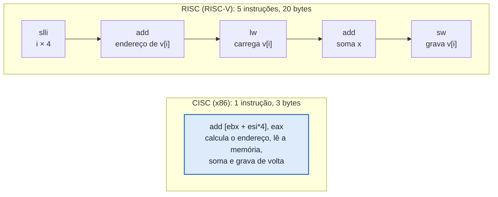
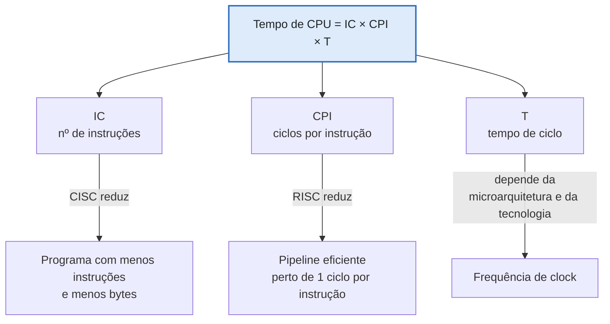
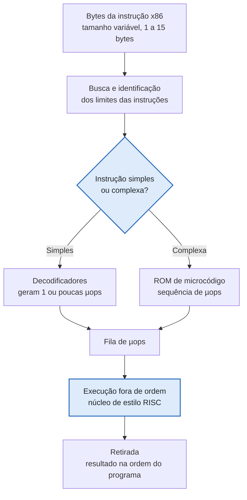
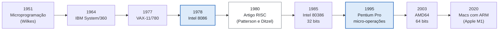
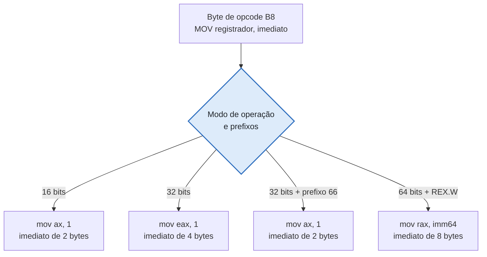
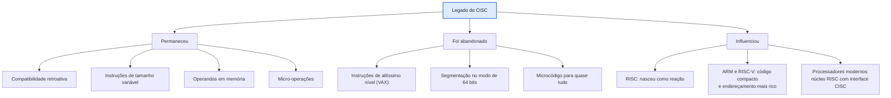

# Entrega 12 — Comparação, Evolução e Legado

| Campo | Descrição |
|---|---|
| **Objeto estudado** | Arquitetura CISC (*Complex Instruction Set Computer*), com a arquitetura x86 como caso principal |
| **Objeto de comparação** | Arquitetura RISC (*Reduced Instruction Set Computer*), com ARM, RISC-V e MIPS como exemplos |
| **Entrega** | 12 — Comparação, Evolução e Legado |

## Resumo

O **CISC** nasceu para aproximar o hardware das linguagens de alto nível, com instruções poderosas, de **tamanho variável** e com **operandos na memória**, quando a memória era cara e os compiladores eram simples. O **RISC** surgiu no início dos anos 1980 como crítica a essa abordagem: instruções simples e regulares, arquitetura *load/store* e foco no pipeline. A comparação mostra um contraste de **filosofias**: o CISC economiza instruções e bytes de código; o RISC simplifica o hardware e facilita o paralelismo. Na prática, o debate foi **resolvido por convergência**. Desde o Pentium Pro (1995), os processadores x86 **traduzem instruções CISC em micro-operações simples**, executadas por um núcleo interno de estilo RISC, enquanto o ARM e o RISC-V ganharam instruções mais elaboradas. O CISC deixou como legado a **compatibilidade retroativa**, a **densidade de código**, a **microprogramação** e um ecossistema de software que mantém o x86 dominante em PCs e servidores e a *z/Architecture* em mainframes. Foram abandonadas as instruções de alto nível muito complexas, como as do VAX, e boa parte do legado de 16 bits no modo de 64 bits.

---
# Parte 1 — Comparação

## 1.1 Objeto escolhido

O objeto escolhido é o **RISC**, por ser o contraponto histórico direto do CISC: o conjunto reduzido de instruções foi proposto como resposta explícita aos problemas do CISC (Patterson e Ditzel, 1980). Como exemplos reais, usamos **x86** (CISC) e **ARM** e **RISC-V** (RISC).

## 1.2 Critérios utilizados

Finalidade, organização, processamento, armazenamento, comunicação (entrada e saída), programação, paralelismo, desempenho, vantagens e limitações.

## 1.3 Tabela comparativa

| Critério | CISC (ex.: x86, VAX, IBM z) | RISC (ex.: ARM, RISC-V, MIPS) |
|---|---|---|
| **Finalidade** | Reduzir a distância entre a linguagem de alto nível e o hardware, com instruções que fazem muito trabalho cada uma | Executar instruções simples muito rápido, deixando a otimização para o compilador |
| **Organização** | Muitas instruções e modos de endereçamento; controle tradicionalmente **microprogramado** | Poucas instruções, formato regular; controle tradicionalmente **direto** (*hardwired*) |
| **Formato das instruções** | **Tamanho variável** (no x86, de 1 a 15 bytes) | **Tamanho fixo** (normalmente 32 bits; há formatos compactos opcionais) |
| **Processamento** | Uma instrução pode levar vários ciclos e fazer operações compostas | Idealmente uma instrução por ciclo no pipeline |
| **Armazenamento (acesso à memória)** | Instruções aritméticas podem usar operandos **na memória** | Arquitetura **load/store**: só `load` e `store` acessam a memória |
| **Registradores** | Poucos nas versões clássicas (8 no x86 de 32 bits; 16 no x86-64) | Muitos (32 é comum) |
| **Programação** | Assembly mais curto; código compacto (alta densidade) | Assembly mais longo; código mais fácil de otimizar pelo compilador |
| **Entrada e saída** | x86 tem espaço de E/S separado (`IN`/`OUT`) além da E/S mapeada em memória | Predomina a E/S mapeada em memória |
| **Paralelismo** | Pipeline mais difícil por causa de instruções de tamanho e duração variáveis; contornado com micro-operações | Pipeline e superescalaridade mais naturais |
| **Desempenho** | Menos instruções por programa, mas mais ciclos por instrução (nas máquinas clássicas) | Mais instruções por programa, mas menos ciclos por instrução |
| **Vantagens** | Compatibilidade retroativa, densidade de código, ecossistema de software | Hardware simples, menor consumo, projeto mais rápido, pipeline eficiente |
| **Limitações** | Decodificação complexa e custosa em área e energia; legado acumulado | Código maior; mais dependência da qualidade do compilador |

## 1.4 Exemplo concreto: a mesma operação nas duas arquiteturas

Operação em C, com `v` sendo um vetor de inteiros de 32 bits:

```c
v[i] = v[i] + x;
```

Considere `EBX`/`s0`/`x0` = endereço de `v`, `ESI`/`s1`/`x1` = índice `i` e `EAX`/`a0`/`w2` = valor `x`.

**x86 (CISC): 1 instrução**

```nasm
add [ebx + esi*4], eax        ; lê a memória, soma e grava de volta
```

**RISC-V (RISC): 5 instruções**

```asm
slli t0, s1, 2                # t0 = i * 4 (calcula o deslocamento)
add  t0, s0, t0               # t0 = endereço de v[i]
lw   t1, 0(t0)                # carrega v[i]
add  t1, t1, a0               # soma x
sw   t1, 0(t0)                # grava v[i]
```

**ARM64 (RISC com endereçamento mais rico): 3 instruções**

```asm
ldr w3, [x0, x1, lsl #2]      // carrega v[i] (índice escalado embutido)
add w3, w3, w2                // soma x
str w3, [x0, x1, lsl #2]      // grava v[i]
```

**Codificação em bytes e tamanho do código:**

| Arquitetura | Instruções | Bytes | Observação |
|---|---|---|---|
| x86 | 1 | **3** (`01 04 B3`) | `01` = `ADD r/m32, r32`; ModR/M `04` (`mod=00`, `reg=EAX`, `r/m=100` → há SIB); SIB `B3` (escala ×4, índice ESI, base EBX) |
| RISC-V (base) | 5 | **20** | 5 × 4 bytes |
| ARM64 | 3 | **12** | 3 × 4 bytes |

O byte ModR/M e o SIB são os mesmos mecanismos estudados na Entrega 10. Note também que o ARM64 adotou um modo de endereçamento com índice escalado, e que a extensão **Zba** do RISC-V acrescenta `sh2add`, que reduz o exemplo a 4 instruções. É um caso de RISC incorporando recursos típicos de CISC.

**Figura 1 — Mesma operação `v[i] += x`: no CISC uma instrução faz tudo; no RISC o acesso à memória é separado da soma**



*O x86 usa menos instruções e menos bytes; o RISC usa instruções mais simples, cada uma fácil de colocar no pipeline.*

## 1.5 Desempenho: o compromisso entre instruções e ciclos

O tempo de execução de um programa depende de três fatores:

```text
Tempo de CPU = Nº de instruções (IC) × Ciclos por instrução (CPI) × Tempo de ciclo (T)
```

- **CISC clássico:** reduz o **IC**, mas tende a aumentar o **CPI**.
- **RISC:** reduz o **CPI** (perto de 1 com pipeline), mas aumenta o **IC**.

**Exemplo didático para `v[i] += x` (valores hipotéticos, não medidos):**

| Máquina | IC | CPI | Ciclos totais |
|---|---|---|---|
| CISC clássico (multiciclo) | 1 | 8 | 1 × 8 = **8** |
| RISC com pipeline | 5 | 1 | 5 × 1 = **5** |

Esse tipo de raciocínio sustentou a defesa do RISC. O estudo de **Emer e Clark (1984)** sobre o VAX-11/780 mostrou que, na prática, cada instrução custava em média cerca de 10 ciclos (conferir o valor exato no artigo), o que reforçou a crítica às instruções complexas.

**Figura 2 — Equação de desempenho: CISC e RISC atacam fatores diferentes**



Hoje a diferença de desempenho vem mais da **microarquitetura** (pipeline, previsão de desvios, caches) do que do conjunto de instruções em si. Estudos como o de Blem et al. (2013), que comparou x86 e ARM contemporâneos, apontam essa conclusão.

## 1.6 Vantagens e limitações

| | CISC | RISC |
|---|---|---|
| **Vantagens** | Código compacto (menos pressão sobre o cache de instruções) · compatibilidade com décadas de software · instruções com memória embutida facilitam o assembly | Decodificação simples · pipeline previsível · menor consumo de energia · projeto mais rápido |
| **Limitações** | Decodificador complexo e caro · instruções de duração variável dificultam o pipeline · muitos recursos legados raramente usados | Código maior · desempenho depende do compilador · ecossistema novo precisa ser reconstruído |

## 1.7 A fronteira atual: o núcleo x86 traduz CISC em micro-operações

Os x86 modernos não executam as instruções CISC diretamente. O decodificador as converte em **micro-operações** (µops) simples, parecidas com instruções RISC, e o núcleo executa essas µops fora de ordem. O exemplo `add [ebx + esi*4], eax` vira, tipicamente, uma sequência de **carga**, **soma** e **armazenamento** (o número exato varia conforme a microarquitetura).

**Figura 3 — Pipeline de um x86 moderno: instruções CISC viram µops, e instruções raras usam microcódigo**



*A interface é CISC (compatível com o software antigo); o interior é RISC. Por isso a comparação vale mais como contraste de filosofias do que como descrição rígida de máquinas atuais.*

---
# Parte 2 — Evolução

## 2.1 Antecedentes

| Antecedente | Contribuição para o CISC |
|---|---|
| **Microprogramação** (Maurice Wilkes, 1951) | Permitiu implementar instruções complexas como sequências de microinstruções, tornando viável um conjunto de instruções rico |
| **Contexto econômico dos anos 1960–70** | Memória principal cara e lenta e compiladores imaturos: instruções poderosas economizavam memória e facilitavam a programação |
| **IBM System/360** (1964) | Família de máquinas compatíveis com a mesma arquitetura, apoiada em microcódigo; origem da ideia de compatibilidade |
| **DEC PDP-11** (1970) e **VAX-11/780** (1977) | Modos de endereçamento ortogonais e instruções muito complexas (strings, filas, polinômios) |

## 2.2 Principais mudanças

- **Dos grandes computadores aos microprocessadores:** Intel 4004 (1971), 8080 (1974), Motorola 68000 (1979) e Intel 8086 (1978), origem do x86.
- **De 16 para 32 bits:** Intel 80386 (1985), com modo protegido e memória virtual paginada.
- **A crítica ao CISC (anos 1970–80):** estudos mostraram que os programas usavam, na maior parte do tempo, poucas instruções simples, e que o microcódigo trazia custo sem benefício proporcional. Surgiram o IBM 801, o RISC de Berkeley e o MIPS de Stanford.
- **A adaptação:** em vez de desaparecer, o CISC passou a traduzir suas instruções para µops (Pentium Pro, 1995).
- **De 32 para 64 bits:** AMD64 (2003), adotado depois pela Intel.

**Figura 4 — Linha do tempo do CISC e do RISC**



*Em azul: os marcos centrais da linhagem x86 (origem e adaptação ao RISC).*

## 2.3 Evolução tecnológica do x86

| Processador | Ano | Mudança principal |
|---|---|---|
| 8086 | 1978 | Base do conjunto de instruções; 16 bits; segmentação |
| 80286 | 1982 | Modo protegido de 16 bits |
| 80386 | 1985 | 32 bits, paginação e memória virtual |
| 80486 | 1989 | Pipeline, unidade de ponto flutuante e cache integrados |
| Pentium | 1993 | Superescalar (duas instruções por ciclo) |
| Pentium Pro | 1995 | Tradução para µops, execução fora de ordem e especulativa |
| MMX, SSE, AVX | 1997 a 2011 | Instruções vetoriais (SIMD) |
| AMD64 | 2003 | 64 bits, 16 registradores de uso geral |

## 2.4 Possíveis sucessores

| Sucessor | Situação |
|---|---|
| **RISC (ARM)** | Domina celulares e embarcados; cresce em notebooks (Macs com Apple Silicon, 2020) e servidores |
| **RISC-V** | Conjunto de instruções aberto, em expansão em embarcados e pesquisa |
| **Alpha** (DEC, 1992) | RISC criado como sucessor do VAX; descontinuado |
| **PowerPC** | Substituiu o 68000 nos Macintosh (1994); depois foi substituído pelo x86 (2006) |
| **Itanium** (Intel/HP, EPIC/VLIW) | Tentativa de substituir o x86; fracasso comercial, em parte pela falta de compatibilidade |
| **x86-64** | Na prática, o "sucessor" do CISC clássico foi o próprio CISC, em versão híbrida |

## 2.5 Sistemas relacionados

| Sistema | Relação com o CISC |
|---|---|
| **IBM System/360 → z/Architecture** | Mainframes que ainda executam programas escritos para o System/360 |
| **PDP-11 → VAX** | O VAX foi projetado como extensão compatível do PDP-11 |
| **Motorola 68000 → ColdFire** | Macintosh, Amiga e Atari ST; o ColdFire é derivado do 68k |
| **Intel 8051** | Família de microcontroladores de enorme longevidade |
| **x86 → AMD64** | Extensão de 64 bits que manteve a compatibilidade |

## 2.6 O que permaneceu e o que foi modificado

| Permaneceu | Foi modificado |
|---|---|
| Conjunto de instruções rico, de tamanho variável | A execução interna passou a usar µops, em vez de microcódigo para tudo |
| Compatibilidade retroativa | A largura passou de 16 para 32 e depois para 64 bits |
| Operandos em memória dentro das instruções | Pipeline, execução fora de ordem e previsão de desvios |
| Modos de endereçamento flexíveis (ModR/M e SIB) | Segmentação praticamente abandonada no modo de 64 bits |

### Exemplo: o mesmo opcode em três gerações

O opcode `B8` (`MOV` com valor imediato) existe desde o 8086 e continua válido. O que muda é a interpretação conforme o modo de operação e os prefixos:

| Modo | Bytes | Instrução | Observação |
|---|---|---|---|
| 16 bits (8086) | `B8 01 00` | `mov ax, 1` | Imediato de 16 bits |
| 32 bits (80386) | `B8 01 00 00 00` | `mov eax, 1` | Imediato de 32 bits |
| 32 bits com prefixo `66` | `66 B8 01 00` | `mov ax, 1` | O prefixo recupera o operando de 16 bits |
| 64 bits (AMD64) | `48 B8` + 8 bytes | `mov rax, imm64` | O prefixo REX.W amplia para 64 bits |

**Figura 5 — Compatibilidade: o mesmo byte é interpretado conforme o modo do processador**



*A compatibilidade custa complexidade: o decodificador precisa conhecer todos esses casos. É o preço que o x86 paga pela herança de 1978.*

---
# Parte 3 — Legado

## 3.1 Principais contribuições

- **Compatibilidade de arquitetura:** a ideia de que o software antigo continua rodando em hardware novo (System/360, x86).
- **Microprogramação:** tornou o projeto de CPUs sistemático e flexível, e permite corrigir ou estender instruções com atualizações de microcódigo.
- **Alta densidade de código:** economizou memória quando ela era cara e ainda ajuda no uso do cache.
- **Ecossistema de software:** o x86 sustentou décadas de sistemas operacionais, compiladores e aplicativos (DOS, Windows, Linux).

## 3.2 Conceitos que permaneceram

| Conceito | Onde aparece hoje |
|---|---|
| Compatibilidade retroativa | x86-64 e z/Architecture |
| Instruções de tamanho variável | x86 e z/Architecture |
| Operandos em memória dentro da instrução | Instruções do x86 como `add [mem], reg` |
| Tradução em micro-operações | Prática padrão em processadores de alto desempenho |
| Microcódigo para casos raros ou complexos | Instruções complexas do x86 e atualizações de microcódigo |
| Extensões SIMD (SSE, AVX) | Ganho de desempenho sem quebrar a compatibilidade |

## 3.3 Características abandonadas

| Característica | O que aconteceu |
|---|---|
| Instruções de altíssimo nível (VAX: `POLY`, `INSQUE`, `MOVC3`) | Raramente geradas por compiladores; a ideia de reduzir a distância semântica no hardware foi abandonada |
| Microcódigo para quase tudo | Hoje as instruções comuns são decodificadas diretamente em µops |
| Segmentação e modos antigos do x86 | Praticamente inutilizados no modo de 64 bits (modelo de memória plano) |
| Instruções BCD (`AAA`, `DAA`) | Inválidas no modo de 64 bits |
| Instruções como `ENTER` e `LOOP` | Mantidas por compatibilidade, mas pouco usadas por compiladores modernos |

## 3.4 Influência sobre outras tecnologias

- **Nasceu a reação RISC:** o conjunto reduzido foi proposto como crítica direta ao CISC.
- **Decodificação em µops:** estratégia adotada para trazer o paralelismo do RISC a um conjunto de instruções CISC.
- **Fusão de instruções:** o x86 pode combinar pares comuns (como comparação seguida de desvio) em uma única µop, e ideias semelhantes são discutidas para o RISC-V.
- **Código compacto em arquiteturas RISC:** o **Thumb** do ARM e a extensão **C** do RISC-V usam instruções de 16 bits para recuperar a densidade de código típica do CISC.
- **Modos de endereçamento mais ricos no RISC:** o ARM64 tem índice escalado, e o RISC-V ganhou `sh2add` (Zba), como visto no exemplo da seção 1.4.
- **Lição de ecossistema:** arquiteturas vencem tanto por software e compatibilidade quanto por mérito técnico, o que explica a sobrevivência do x86 e o fracasso do Itanium.

**Figura 6 — Legado do CISC: o que permaneceu, o que foi abandonado e o que influenciou outras tecnologias**



## 3.5 Relevância técnica

- O **x86-64** continua dominante em desktops, notebooks e servidores, e a **z/Architecture** segue em sistemas bancários e corporativos.
- Para o estudo de arquitetura, o CISC permite entender **decodificação, microcódigo, modos de endereçamento e o custo da compatibilidade**, conceitos que aparecem na codificação ModR/M e SIB vista na Entrega 10.
- A convergência com o RISC mostra que a **interface** (conjunto de instruções) e a **implementação** (microarquitetura) podem evoluir separadamente.

## 3.6 Relevância histórica

- O CISC marca a passagem dos grandes computadores para os **microprocessadores** e a origem da noção de **família de computadores** compatíveis.
- O debate **CISC × RISC** foi um dos mais importantes da arquitetura de computadores e levou ao trabalho de **Hennessy e Patterson**, premiados com o Prêmio Turing de 2017 pela abordagem quantitativa ao projeto de computadores.
- A história do x86 mostra que **decisões de compatibilidade** podem pesar mais que a elegância técnica.

## 3.7 Conclusão

O CISC não foi "derrotado" pelo RISC: Ele **absorveu** as ideias do RISC no interior do processador e **preservou** a interface que sustenta o software existente. Já o RISC adotou do CISC a densidade de código e modos de endereçamento mais ricos. O legado mais durável é a ideia de que o conjunto de instruções é um **contrato estável** entre hardware e software.

---
## Fontes

### Livros e manuais

| # | Referência | Observação |
|---|---|---|
| 1 | STALLINGS, W. *Computer Organization and Architecture* (11ª ed.). [Link](https://os.ecci.ucr.ac.cr/ci0114/material/Stallings/Computer-Organization-Architecture-11th.pdf) | Base principal (capítulo sobre RISC e capítulos de conjunto de instruções; conferir a numeração na edição utilizada) |
| 2 | PATTERSON, D. A.; HENNESSY, J. L. *Computer Organization and Design* (5ª ed.). [Link](https://www.youseficlass.ir/wp-content/uploads/2023/07/Computer_Organization_and_Design_5th_Edition_David_A_Patterson_John_watermark.pdf) | Equação de desempenho (IC × CPI × T) e comparação CISC × RISC (seções 1.5 e 1.7) |
| 3 | TANENBAUM, A. S. *Structured Computer Organization*. [Link](https://dspace.sxcjpr.edu.in/jspui/bitstream/123456789/1057/1/Andrew%20S.%20Tanenbaum%20-%20Structured%20Computer%20Organization.pdf) | Apoio: microprogramação e história das arquiteturas |
| 4 | Intel, *Software Developer's Manuals*. [Link](https://www.intel.com/content/www/us/en/developer/articles/technical/intel-sdm.html) | Vol. 1 (arquitetura básica e modos de operação); Vol. 2 (formato de instrução, ModR/M, SIB, prefixos) |
| 5 | AMD, *AMD64 Architecture Programmer's Manual*. [Link](https://docs.amd.com) | Extensão de 64 bits (seção 2.3) |
| 6 | CARTER, P. *PC Assembly Language*. [Link](https://pacman128.github.io/static/pcasmbook.pdf) | Apoio: modos 16, 32 e 64 bits |
| 7 | WATERMAN, A.; ASANOVIĆ, K. (eds.). *The RISC-V Instruction Set Manual*. [Link](https://riscv.org/technical/specifications/) | Extensões C e Zba (seções 1.4 e 3.4) |

---
### Artigos acadêmicos

| # | Referência | Observação |
|---|---|---|
| 1 | PATTERSON, D. A.; DITZEL, D. R. *The Case for the Reduced Instruction Set Computer*. ACM SIGARCH Computer Architecture News, v. 8, n. 6, p. 25–33, 1980. [DOI](https://doi.org/10.1145/641914.641917) · [Cópia](https://cs.utexas.edu/~fussell/courses/cs352h/papers/risc.pdf) | Argumentos que fundamentaram o RISC (seções 1.1 e 1.5) |
| 2 | EMER, J. S.; CLARK, D. W. *A Characterization of Processor Performance in the VAX-11/780*. 11th ISCA, p. 301–310, 1984. [DBLP](https://dblp1.uni-trier.de/rec/conf/isca/EmerC84.html) · [Cópia](https://people.csail.mit.edu/emer/media/papers/1984.05.isca.vax.pdf) | Desempenho real de um CISC clássico (seção 1.5) |
| 3 | WILKES, M. V. *The Best Way to Design an Automatic Calculating Machine*. Manchester University Computer Inaugural Conference, 1951. (buscar pelo título) | Origem da microprogramação (seção 2.1) |
| 4 | BLEM, E.; MENON, J.; SANKARALINGAM, K. *Power Struggles: Revisiting the RISC vs. CISC Debate on Contemporary ARM and x86 Architectures*. HPCA, 2013. (buscar pelo título) | Mostra que a microarquitetura pesa mais que o conjunto de instruções (seção 1.5) |
| 5 | BHANDARKAR, D.; CLARK, D. W. *Performance from Architecture: Comparing a RISC and a CISC with Similar Hardware Organization*. ASPLOS, 1991. (buscar pelo título) | Comparação direta entre RISC e CISC com organização de hardware semelhante |

---
### Referências gerais (apoio)

Servem para consulta rápida e compreensão inicial dos conceitos (**Não substituem os livros e documentos oficiais**).

| Referência | Link |
|---|---|
| Complex instruction set computer (CISC) | <https://en.wikipedia.org/wiki/Complex_instruction_set_computer> |
| Reduced instruction set computer (RISC) | <https://en.wikipedia.org/wiki/Reduced_instruction_set_computer> |
| Microcode | <https://en.wikipedia.org/wiki/Microcode> |
| Micro-operation | <https://en.wikipedia.org/wiki/Micro-operation> |
| x86 | <https://en.wikipedia.org/wiki/X86> |
| VAX | <https://en.wikipedia.org/wiki/VAX> |
| IBM System/360 | <https://en.wikipedia.org/wiki/IBM_System/360> |
| z/Architecture | <https://en.wikipedia.org/wiki/Z/Architecture> |
| Motorola 68000 | <https://en.wikipedia.org/wiki/Motorola_68000> |
| Compiler Explorer (ver o mesmo código C em x86, ARM e RISC-V) | <https://godbolt.org/> |
