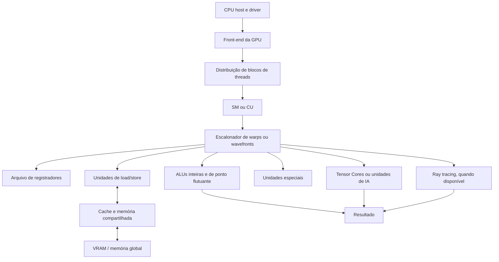

# 3. Unidades de Processamento e Execução

## 3.1 Processor Overview
Uma GPU não possui uma única CPU central responsável por executar todas as operações. Ela é formada por várias unidades de execução. Na NVIDIA, essas unidades são chamadas de **Streaming Multiprocessors (SMs)**; na AMD, são chamadas de **Compute Units (CUs)**.

Cada SM ou CU recebe blocos de threads e executa grupos delas em paralelo. A CPU do computador atua como host: prepara os dados, inicia os kernels e coordena o programa, enquanto a GPU executa as partes com maior paralelismo.

## 3.2 Registers
Cada thread possui registradores para guardar operandos, endereços e resultados temporários. Eles são a forma mais rápida de armazenamento disponível para a execução, mas sua quantidade é limitada.

Quando um kernel utiliza muitos registradores, menos threads podem permanecer ativas em cada SM ou CU. Esse efeito reduz a ocupação da unidade e pode diminuir o desempenho.

## 3.3 ALU
As unidades aritméticas e lógicas executam operações inteiras, de ponto flutuante, comparações, deslocamentos e operações lógicas. Em vez de uma única ALU, a GPU possui muitas ALUs trabalhando sobre diferentes dados.

Além das ALUs gerais, GPUs modernas podem possuir:

- **unidades de ponto flutuante:** executam cálculos como soma e multiplicação;
- **unidades de carregamento e armazenamento:** movimentam dados entre registradores, caches e memória;
- **unidades de funções especiais:** calculam operações como seno, cosseno e divisão;
- **Tensor Cores ou equivalentes:** aceleram multiplicações de matrizes e operações usadas em IA;
- **unidades de ray tracing:** aceleram interseções de raios e estruturas usadas em gráficos tridimensionais.

## 3.4 Control Unit
O controle da GPU é distribuído. O driver e o runtime enviam kernels e comandos; o front-end da GPU recebe esses comandos; e os escalonadores de cada SM ou CU distribuem os warps ou wavefronts para as unidades disponíveis.

O escalonador escolhe um grupo de threads pronto para executar quando há recursos disponíveis. O warp, na NVIDIA, e o wavefront, na AMD, seguem uma instrução comum sobre dados diferentes. Se as threads do mesmo grupo tomam caminhos condicionais diferentes, ocorre divergência e parte das unidades pode ficar sem trabalho útil.

## 3.5 Clock
As unidades de execução trabalham com sinais de clock que sincronizam as etapas internas. A frequência varia conforme o modelo, a temperatura, o consumo e a carga de trabalho. A frequência mais alta não garante sozinha mais desempenho, pois também são importantes a quantidade de unidades, a largura de banda da memória e a eficiência do kernel.

## 3.6 Instruction Cycle
O ciclo de execução de uma GPU pode ser resumido assim:

1. **Fetch:** a instrução do kernel é buscada na memória de instruções ou cache.
2. **Decode:** o hardware identifica a operação e os recursos necessários.
3. **Schedule:** o escalonador seleciona um warp ou wavefront pronto e verifica se há registradores, memória e unidades funcionais disponíveis.
4. **Execute:** as ALUs ou unidades especializadas executam a operação em paralelo.
5. **Memory access:** quando necessário, dados são lidos ou escritos em registradores, memória compartilhada, caches ou VRAM.
6. **Commit:** os resultados são mantidos para a próxima instrução ou enviados para a memória e para a próxima etapa do kernel.

Esse ciclo acontece simultaneamente em muitos grupos de threads. Quando um grupo espera dados da memória, outro pode ser escalonado para ocupar a unidade de execução.

## 3.7 CPU Diagram

O diagrama representa uma organização geral. Os nomes, quantidades e funções exatas variam entre fabricantes e gerações de GPU.

## 3.8 Advantages
As principais vantagens dessa organização são:

- grande quantidade de operações executadas simultaneamente;
- aproveitamento eficiente de tarefas que repetem a mesma operação sobre muitos dados;
- unidades especializadas para gráficos, matrizes, vídeo e inteligência artificial;
- capacidade de esconder parte da latência da memória mantendo vários warps ou wavefronts ativos;
- divisão de responsabilidades entre a CPU, que coordena, e a GPU, que acelera o processamento paralelo.

## 3.9 Limitations
As principais limitações são:

- tarefas sequenciais ou com muitas dependências aproveitam pouco o paralelismo;
- divergência entre threads do mesmo warp ou wavefront reduz a eficiência;
- falta de registradores, memória compartilhada ou VRAM limita a quantidade de trabalho ativo;
- acessos irregulares à memória aumentam a latência;
- sincronização frequente faz threads esperarem umas pelas outras;
- transferência de dados entre CPU e GPU pode custar mais tempo que o cálculo;
- unidades especializadas podem ser pouco úteis para operações que não correspondem ao seu propósito.

Portanto, a GPU não é automaticamente mais rápida que a CPU. O melhor resultado ocorre quando o problema possui muitos trabalhos independentes, dados organizados e operações compatíveis com as unidades disponíveis.

## 3.10 Sincronização e Paralelismo
Threads de um mesmo bloco podem cooperar por meio da memória compartilhada e de barreiras de sincronização. A barreira impede que uma thread avance antes que as outras threads do grupo alcancem o mesmo ponto.

Blocos diferentes são planejados para serem independentes, pois podem ser executados em SMs ou CUs distintos. Quando existe dependência entre kernels, o programa precisa aguardar o término de uma etapa antes de iniciar a próxima. Essa espera garante a ordem correta, mas reduz o paralelismo.
