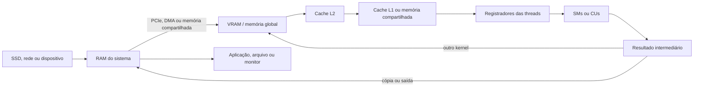

# 4. Memory Organization

## 4.1 Memory Hierarchy
Uma GPU utiliza uma hierarquia de memória. Memórias menores e mais próximas das unidades de cálculo são mais rápidas, enquanto memórias maiores têm maior latência. Essa organização permite armazenar temporariamente os dados mais usados e reduzir acessos demorados.

A hierarquia típica é:

1. **Registradores:** pertencem às threads e armazenam valores temporários.
2. **Memória compartilhada e cache L1:** ficam próximos aos SMs ou CUs e permitem reutilizar dados entre threads do mesmo bloco.
3. **Cache L2:** é compartilhado por várias unidades de execução.
4. **Memória global ou VRAM:** armazena grandes volumes de dados, como imagens, matrizes, tensores e modelos de IA.
5. **RAM do sistema e armazenamento externo:** ficam fora da GPU e são acessados por meio do sistema hospedeiro.

## 4.2 RAM
Em placas dedicadas, a GPU possui uma memória própria, normalmente chamada VRAM. Ela pode utilizar tecnologias como GDDR ou HBM, que oferecem alta largura de banda para movimentar muitos dados por segundo.

A RAM do computador também pode fornecer dados à GPU. A CPU prepara programas e informações na RAM, e o driver pode transferi-los para a VRAM por PCIe. Em GPUs integradas, CPU e GPU podem compartilhar a memória principal.

## 4.3 ROM
ROM não é usada como área principal para armazenar os dados processados pela GPU. Porém, a placa possui memória não volátil, como flash, para guardar firmware, informações de inicialização e configurações básicas. Esse conteúdo permanece mesmo quando o equipamento é desligado e é carregado durante a inicialização.

## 4.4 Cache
As caches L1 e L2 guardam cópias de dados acessados recentemente. A L1 normalmente é mais próxima de cada unidade de execução, enquanto a L2 atende várias unidades. O uso eficiente da cache reduz a necessidade de buscar dados na VRAM.

Além das caches, a memória compartilhada pode ser organizada pelo programador para armazenar dados reutilizados pelas threads de um bloco. Ela é rápida, mas tem capacidade limitada e exige sincronização correta.

## 4.5 Storage
A GPU não costuma possuir armazenamento permanente para arquivos de usuário. Modelos, programas, imagens e vídeos geralmente ficam em SSD ou HD e são carregados pelo sistema operacional. Depois, os dados necessários são transferidos para a RAM e, quando necessário, para a VRAM.

Portanto, é importante separar armazenamento de memória: o SSD mantém os arquivos quando o computador está desligado, enquanto registradores, caches, VRAM e RAM mantêm dados durante a execução.

## 4.6 Memory Capacity
Não existe uma capacidade única para todas as GPUs. Ela varia conforme o modelo e o uso. Como referência, GPUs de consumo podem ter alguns gigabytes de VRAM, enquanto placas profissionais e aceleradores de servidores podem ter dezenas ou centenas de gigabytes, especialmente quando usam HBM.

A capacidade disponível para cada aplicação também é reduzida por buffers gráficos, sistema operacional, bibliotecas, pesos do modelo e dados intermediários. Quando a VRAM não é suficiente, parte dos dados pode ser movida para a RAM ou para o armazenamento, mas isso aumenta bastante a latência.

## 4.7 Comparison with Modern Systems
| Área | Função | Velocidade e limitação |
|---|---|---|
| Registradores | Valores temporários de cada thread. | Muito rápidos, mas com pouca capacidade. |
| Memória compartilhada | Dados reutilizados por threads do mesmo bloco. | Rápida, limitada e exige sincronização. |
| Cache L1/L2 | Cópias de dados acessados com frequência. | Reduz acessos à VRAM, mas possui capacidade limitada. |
| VRAM | Imagens, matrizes, tensores e modelos. | Alta largura de banda, porém maior latência que registradores e caches. |
| RAM | Dados preparados pela CPU e transferidos para a GPU. | Maior capacidade, mas a transferência por PCIe pode ser lenta. |
| SSD/HD | Arquivos, programas, modelos e configurações permanentes. | Não perde dados ao desligar, mas é muito mais lento que as memórias da GPU. |

## 4.8 Relação com o Funcionamento
O desempenho da GPU depende da movimentação dos dados pela hierarquia. Kernels rápidos precisam acessar os dados de forma organizada, reutilizar informações próximas às unidades de cálculo e evitar transferências frequentes entre RAM e VRAM.

No processamento gráfico, texturas, vértices e buffers são carregados na VRAM para que a GPU possa renderizar imagens. Em inteligência artificial, pesos, entradas, ativações e gradientes permanecem na VRAM durante as operações matriciais. Se a memória fica cheia ou os dados são acessados de forma desorganizada, as unidades de cálculo podem ficar ociosas.

Assim, a memória não serve apenas para guardar informações: sua capacidade, velocidade, proximidade e forma de acesso influenciam diretamente o desempenho e o tamanho dos problemas que a GPU consegue processar.

## 4.9 Origem e Fluxo dos Dados
Os dados podem vir de arquivos armazenados em SSD ou HD, de dispositivos de entrada, da rede ou de outro processo. A CPU e o sistema operacional carregam esses dados na RAM. Em uma GPU dedicada, o driver e o runtime transferem o que será processado para a VRAM por meio do PCIe. Em GPUs integradas, CPU e GPU podem acessar uma área compartilhada da memória principal.

Depois que os dados chegam à VRAM, as unidades de execução solicitam as informações necessárias. O acesso tenta seguir esta ordem: registradores, memória compartilhada ou cache L1, cache L2 e, por fim, memória global na VRAM. Quando o dado não está em um nível mais rápido, ele precisa ser buscado em um nível mais distante.

Os resultados intermediários ficam em registradores, memória compartilhada, caches ou VRAM. Ao final, podem permanecer na GPU para alimentar outro kernel, ser copiados para a RAM ou ser enviados para um monitor, arquivo ou aplicação.

## 4.10 Ordem de Acesso e Aceleração
O escalonador mantém vários grupos de threads prontos. Quando um grupo espera dados da memória, outro grupo pode utilizar a unidade de execução. Esse mecanismo ajuda a esconder a latência, mas não elimina o custo de buscar dados.

O acesso é acelerado quando as threads leem posições consecutivas da memória, permitindo uma transferência agrupada, e quando os dados são reutilizados na cache ou na memória compartilhada. Em IA, operações matriciais também podem usar unidades especializadas, como Tensor Cores, reduzindo o tempo de cálculo depois que os dados estão disponíveis.

## 4.11 Gargalos e Limitações
- **Transferência CPU-GPU:** o PCIe possui menos largura de banda e maior latência que a memória interna da GPU. Cópias frequentes podem anular o ganho do processamento paralelo.
- **Capacidade da VRAM:** modelos, imagens ou conjuntos de dados maiores que a VRAM precisam ser divididos ou transferidos em partes.
- **Acesso irregular:** leituras espalhadas reduzem o aproveitamento da largura de banda e das caches.
- **Falta de reutilização:** se cada dado é usado uma única vez, a memória compartilhada e as caches ajudam pouco.
- **Sincronização:** threads que precisam esperar umas pelas outras podem deixar unidades de execução ociosas.
- **Troca com a RAM ou armazenamento:** quando faltam dados na VRAM, buscar informações em níveis externos é muito mais lento.

Por isso, o desempenho final depende do equilíbrio entre tempo de cálculo e tempo de movimentação. Uma GPU pode ter grande capacidade de processamento, mas permanecer subutilizada se os dados não forem entregues na velocidade necessária.
